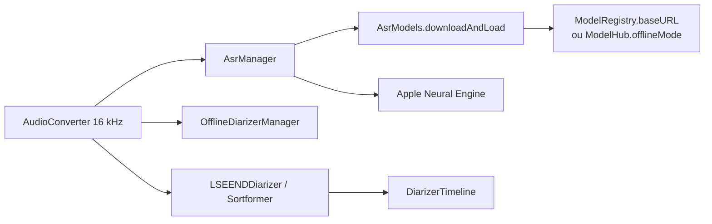

# FluidInference/FluidAudio

> Swift SDK for local audio AI on the Apple Neural Engine, for macOS and iOS app developers.

## The problem
Transcription or diarization on a Mac goes through the CPU or GPU: battery,
memory, and an app that cannot stay alive in the background.
Integrating ONNX or PyTorch models into a Swift app is a project of its own.

## What it actually does
ASR Parakeet TDT v3 (25 European languages) and v2 (English, better recall), SenseVoice and
Paraformer for Mandarin, Parakeet EOU (120M) streaming with end-of-utterance detection.
Inverse text normalization ("two hundred" → "200") via text-processing-rs.
TTS Kokoro (82M, 9 languages, SSML), streaming PocketTTS with voice cloning, Chatterbox in beta.
Offline diarization (Pyannote Community-1: powerset segmentation + WeSpeaker + VBx),
and online LS-EEND (up to 10 speakers, 100 ms frames) or Sortformer (4 speakers, more stable identities).
Speaker embedding extraction, Silero VAD. Real-time factor ~190x on M4 Pro.

## How it is wired


## Trying it
```bash
swift run fluidaudiocli transcribe audio.wav
swift run fluidaudiocli transcribe audio.wav --model-version v2
swift run fluidaudiocli process meeting.wav --mode offline --threshold 0.6 --output es2004a_offline.json
swift run fluidaudiocli diarization-benchmark --mode offline --auto-download --single-file ES2004a
claude mcp add -s user -t http deepwiki https://mcp.deepwiki.com/mcp
```

## Cost and gotchas
Free, entirely local, nothing leaves over the network at inference. But models are downloaded
from HuggingFace on first launch: plan for `REGISTRY_URL` for a mirror, `https_proxy`
behind a firewall, or `ModelHub.offlineMode = true` to forbid any fetch and bundle
your own weights. Sortformer is under the NVIDIA Open Model License, distinct from the other models.

## What it is not
It is not cross-platform: it is Apple, with inference on the ANE and GPU/MPS explicitly avoided.
It is not a turnkey transcription service: it is an SDK to integrate.
It is not a model trainer — the weights are converted by the team and published on HuggingFace.

## Alternatives
The official wrappers react-native-fluidaudio and fluidaudio-rs for another framework;
möbius to convert your own models; text-processing-rs for post-processing.

## For you
The best local choice on Mac for ASR and diarization; useless if your target is not Apple.
