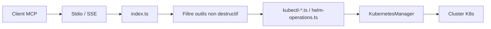

# Flux159/mcp-server-kubernetes

> MCP server that drives a Kubernetes cluster (kubectl, Helm) from an AI assistant, with a non-destructive mode.

## The problem
Diagnosing a pod or deploying a chart requires chaining `kubectl` commands that the assistant cannot run on its own.

## What it actually does
It exposes MCP tools: `kubectl_get`, `describe`, `logs`, `apply`, `scale`, `rollout`, `patch`, `port_forward`, Helm operations, pod cleanup, node management, plus the `k8s-diagnose` prompt. The `ALLOW_ONLY_NON_DESTRUCTIVE_TOOLS` mode removes deletion, uninstall and drain. Secrets are masked in `kubectl get secrets`. OpenTelemetry tracing is optional.

## How it is wired


## Trying it
```bash
claude mcp add kubernetes -- npx mcp-server-kubernetes
ALLOW_ONLY_NON_DESTRUCTIVE_TOOLS=true npx mcp-server-kubernetes
```

## Cost and gotchas
Free. Requires `kubectl` in the `PATH`, a valid kubeconfig, and Helm v3 as an option. The assistant acts with your rights: do not connect it to a production cluster without the non-destructive mode; `kubectl_generic` is disabled in that mode.

## What it is not
Not an operator or a governance tool: it runs commands on behalf of the model. Secret masking does not apply to logs.

## Alternatives
No alternative named in the README.

## For you
Adopt in non-destructive mode: it gives an assistant controlled access to a cluster, useful in MLOps; reserve read/write mode for a test environment.
