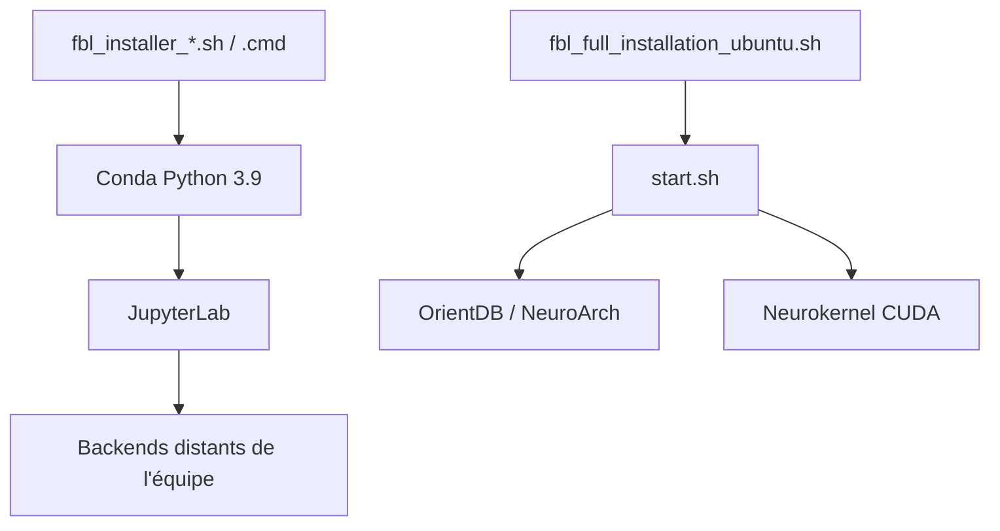

# FlyBrainLab/FlyBrainLab

> Interactive platform for exploring the fruit fly brain and running neural circuits, for researchers.

## The problem
Linking connectome data, 3D visualization and circuit simulation requires several separate tools.

## What it actually does
An entry and installation repository, not the application code. It installs a JupyterLab environment (Python 3.9, conda) that visualizes the data and builds executable circuits. The lightweight installation connects to servers hosted by the team; the full installation adds OrientDB, an FFBO processor and Neurokernel on a CUDA GPU.

## How it is wired


## Trying it
```bash
conda create -n flybrainlab python=3.9 git -y
conda activate flybrainlab
jupyter lab
docker run --name fbl --gpus all -p 9999:8888 -it fruitflybrain/fbl:latest
```

## Cost and gotchas
Full installation: CUDA GPU, Ubuntu, 30 GB of disk, 32 GB of RAM recommended. Without a GPU, no circuit execution. Last push in September 2025.

## What it is not
Not a general-purpose neuroscience tool: it is tied to the fly datasets (Hemibrain, FlyCircuit, L1EM). Reference documentation "coming soon".

## Alternatives
No alternative named in the README.

## For you
Ignore: a computational neuroscience niche, heavy to install, with no direct use in MLOps.
