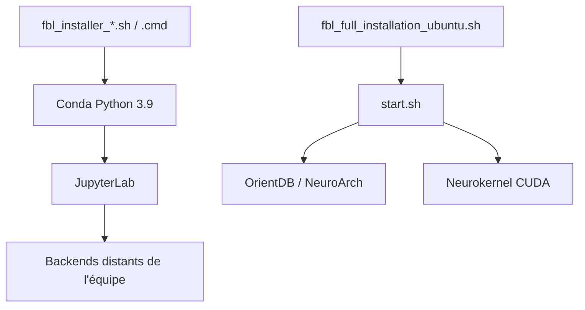

# FlyBrainLab/FlyBrainLab

> Plateforme interactive pour explorer le cerveau de la drosophile et exécuter des circuits neuronaux, pour chercheurs.

## Le problème
Relier données de connectome, visualisation 3D et simulation de circuits demande plusieurs outils séparés.

## Ce que ça fait vraiment
Dépôt d'entrée et d'installation, pas le code de l'application. Il installe un environnement JupyterLab (Python 3.9, conda) qui visualise les données et construit des circuits exécutables. L'installation légère se connecte à des serveurs hébergés par l'équipe ; l'installation complète ajoute OrientDB, un processeur FFBO et Neurokernel sur GPU CUDA.

## Comment c'est branché


## Essayer
```bash
conda create -n flybrainlab python=3.9 git -y
conda activate flybrainlab
jupyter lab
docker run --name fbl --gpus all -p 9999:8888 -it fruitflybrain/fbl:latest
```

## Coût et pièges
Installation complète : GPU CUDA, Ubuntu, 30 Go de disque, 32 Go de RAM conseillés. Sans GPU, pas d'exécution de circuits. Dernier push en septembre 2025.

## Ce que ce n'est pas
Pas un outil généraliste de neurosciences : il est lié aux jeux de données de la mouche (Hemibrain, FlyCircuit, L1EM). Documentation de référence « coming soon ».

## Alternatives
Aucune alternative nommée dans le README.

## Pour toi
Ignorer : niche de neurosciences computationnelles, lourde à installer, sans usage direct en MLOps.

