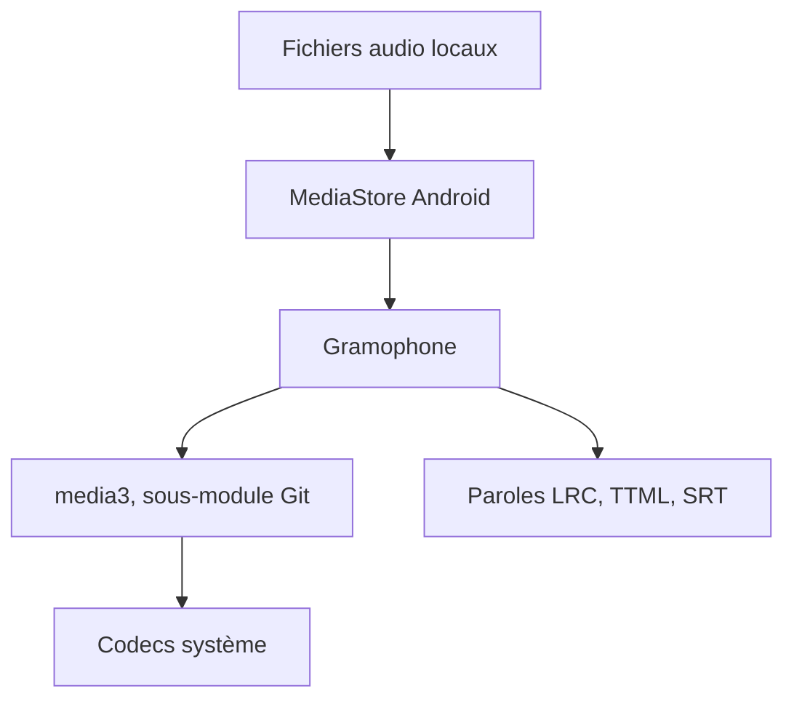

# FoedusProgramme/Gramophone

> Lightweight Android music player, based on media3 and Material 3.

## The problem
Android music players are often heavy or depart from system conventions.

## What it actually does
Gramophone plays local files via MediaStore: search, folder browsing, playlists, natural sorting, synced lyrics (LRC, TTML, SRT, word by word), ReplayGain 2.0 and system equalizers. It relies on system codecs to stay small; a Java ALAC decoder is included. Tracks shorter than 60 seconds are hidden by default.

## How it is wired
Simplified diagram based on the sheet, no diagram provided.


## Trying it
```bash
git submodule update --init --recursive
```
Then create `package.properties` with `releaseType=SelfBuilt` at the root and build with Android Studio.

## Cost and gotchas
Free, installable from F-Droid, IzzyOnDroid or GitHub. Building requires the latest Android Studio beta. Formats such as 32-bit FLAC or xHE-AAC depend on the Android version.

## What it is not
Not a streaming service: local files only. No AI or data features.

## Alternatives
No alternative named in the README.

## For you
Ignore: mobile music player, outside the data / AI / MLOps scope.
