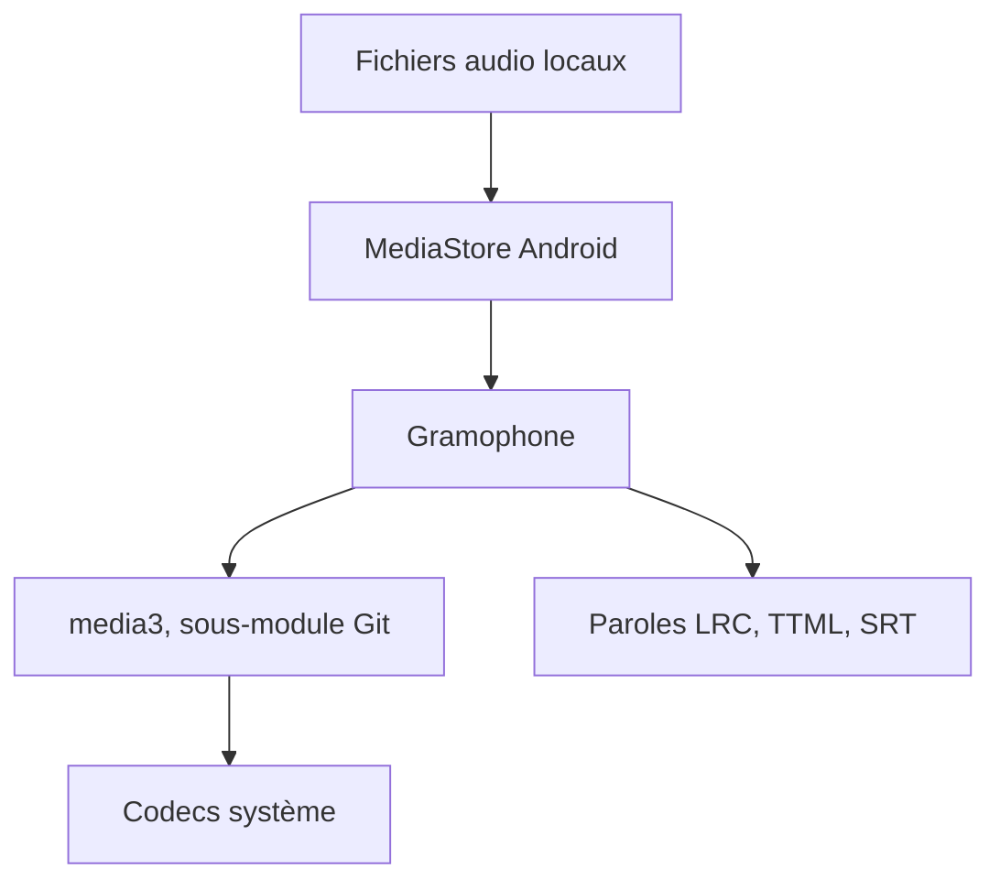

# FoedusProgramme/Gramophone

> Lecteur de musique Android léger, basé sur media3 et Material 3.

## Le problème
Les lecteurs de musique Android sont souvent lourds ou s'écartent des conventions du système.

## Ce que ça fait vraiment
Gramophone lit les fichiers locaux via MediaStore : recherche, navigation par dossier, listes de lecture, tris naturels, paroles synchronisées (LRC, TTML, SRT, mot à mot), ReplayGain 2.0 et égaliseurs système. Il s'appuie sur les codecs du système pour rester petit ; un décodeur ALAC Java est inclus. Les morceaux de moins de 60 secondes sont masqués par défaut.

## Comment c'est branché
Schéma simplifié d'après la fiche, sans diagramme fourni.


## Essayer
```bash
git submodule update --init --recursive
```
Puis créer `package.properties` avec `releaseType=SelfBuilt` à la racine et compiler avec Android Studio.

## Coût et pièges
Gratuit, installable depuis F-Droid, IzzyOnDroid ou GitHub. La compilation exige la dernière bêta d'Android Studio. Les formats comme FLAC 32 bits ou xHE-AAC dépendent de la version d'Android.

## Ce que ce n'est pas
Ce n'est pas un service de streaming : seulement des fichiers locaux. Aucune fonction d'IA ni de données.

## Alternatives
Aucune alternative nommée dans le README.

## Pour toi
À ignorer : lecteur de musique mobile, hors du périmètre data / IA / MLOps.

