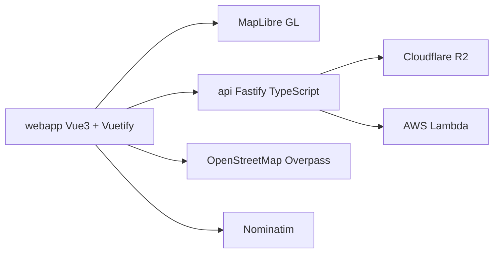

# FoggedLens/deflock

> Collaborative map of automated license plate readers (ALPR) in the United States, for citizens and privacy activists.

## The problem
License plate readers are being deployed massively, with no public inventory. It is impossible to know where they are or what type they are.

## What it actually does
- Displays on a map the ALPRs recorded by the community in OpenStreetMap, with type and direction (the map now lives in the separate deflockhopper_maps repository).
- Explains how to report an ALPR via the DeFlock app or the OpenStreetMap iD editor, using a standardized tag system.
- Maintains a catalog of ALPR makes and models with images and tagging instructions.

## How it is wired

Diagram reconstructed from the README's "Tech Stack" section (no diagram provided).

## Trying it
```bash
# Frontend
cd webapp
bun i
bun dev
# Backend
cd api
bun i
bun dev
```

## Cost and gotchas
Prerequisite: bun. Full operation relies on Cloudflare, AWS, Directus and Zammad: reproducing them is not documented. Migrations in progress (S3 to R2, Leaflet to MapLibre).

## What it is not
Not a reusable library: it is the code of one specific activist site. The data is crowdsourced, so coverage is partial and not guaranteed. Geographic scope is centered on the United States.

## Alternatives
- deflockhopper_maps: repository that now contains the map itself.

## For you
Watch: unrelated to your data/AI/MLOps work, only the example mapping stack (MapLibre, Fastify, R2) and the OSM dataset may be of interest.
