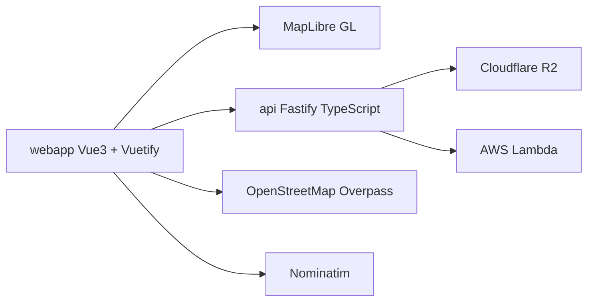

# FoggedLens/deflock

> Carte collaborative des lecteurs automatiques de plaques (ALPR) aux États-Unis, pour citoyens et militants de la vie privée.

## Le problème
Les lecteurs de plaques d'immatriculation se déploient massivement, sans inventaire public. Impossible de savoir où ils sont ni de quel type.

## Ce que ça fait vraiment
- Affiche sur une carte les ALPR recensés par la communauté dans OpenStreetMap, avec type et direction (la carte vit désormais dans le dépôt séparé deflockhopper_maps).
- Explique comment signaler un ALPR via l'app DeFlock ou l'éditeur iD d'OpenStreetMap, avec un système de tags standardisé.
- Tient un catalogue de marques et modèles d'ALPR avec images et instructions de tagging.

## Comment c'est branché

Schéma reconstitué d'après la section « Tech Stack » du README (aucun diagramme fourni).

## Essayer
```bash
# Frontend
cd webapp
bun i
bun dev
# Backend
cd api
bun i
bun dev
```

## Coût et pièges
Prérequis : bun. Le fonctionnement complet s'appuie sur Cloudflare, AWS, Directus et Zammad : les reproduire n'est pas documenté. Migrations en cours (S3 vers R2, Leaflet vers MapLibre).

## Ce que ce n'est pas
Pas une bibliothèque réutilisable : c'est le code d'un site militant précis. Les données sont crowdsourcées, donc couverture partielle et non garantie. Zone géographique centrée sur les États-Unis.

## Alternatives
- deflockhopper_maps : dépôt qui contient désormais la carte elle-même.

## Pour toi
Surveiller : sans lien avec ton métier data/IA/MLOps, seul l'exemple de pile cartographique (MapLibre, Fastify, R2) et le jeu de données OSM peuvent présenter un intérêt.

