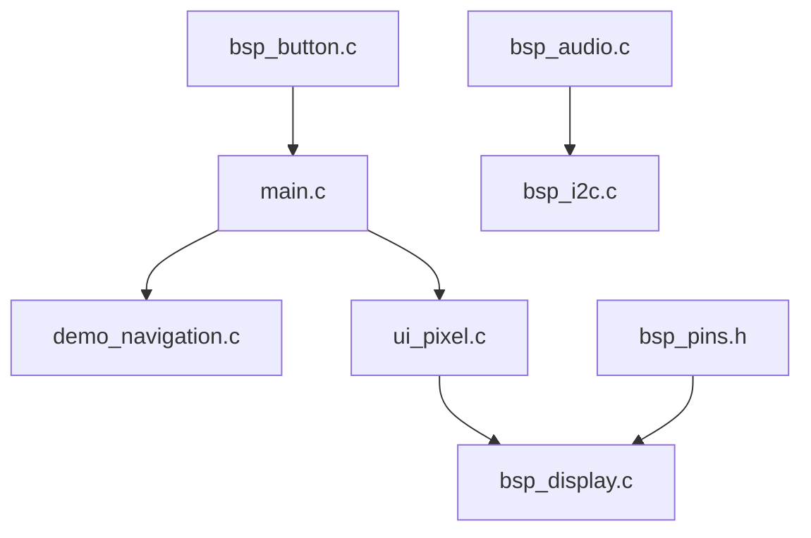

# FoloToy/ai-passport

> Open firmware for a portable ESP32-C3 device with a screen and three buttons, a base for small applications.

## The problem
Building an application on a small connected object requires mastering the screen, buttons, audio and battery.

## What it actually does
- Executable hardware test base: ST7789 display, ADC buttons, ES8311 audio, CW2017 battery.
- Wi-Fi (scan), BLE (advertising) and low-power demos.
- `demo/*` branches: stopwatch, pomodoro, rock-paper-scissors, Tetris, AI desktop companion.
- `AGENTS.md` and five skills guide an AI coding tool; the demo interface must not be reused.

## How it is wired


## Trying it
```bash
git branch -r --list 'origin/demo/*'
git switch main
git switch -c feature/my-passport-app
```

## Cost and gotchas
You need the FoloToy device and the ESP-IDF toolchain. A successful build is not hardware validation; flashing requires your consent and may erase data.

## What it is not
Not a finished application: `main` is only a test base. Capabilities are limited to those the README lists.

## Alternatives
No alternative named in the README.

## For you
Ignore: connected-object platform, outside the data, AI or MLOps field, unless you have an embedded project.
