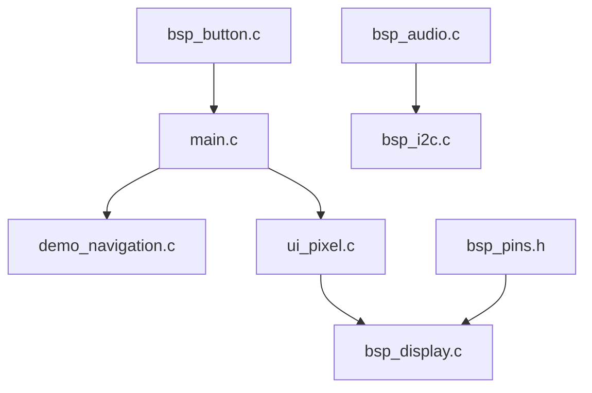

# FoloToy/ai-passport

> Firmware ouvert pour un appareil portable ESP32-C3 à écran et trois boutons, base de petites applications.

## Le problème
Créer une application sur un petit objet connecté demande de maîtriser l'écran, les boutons, l'audio et la batterie.

## Ce que ça fait vraiment
- Base de test matériel exécutable : affichage ST7789, boutons ADC, audio ES8311, batterie CW2017.
- Démos Wi-Fi (balayage), BLE (annonce), basse consommation.
- Branches `demo/*` : chronomètre, pomodoro, pierre-feuille-ciseaux, Tetris, compagnon IA de bureau.
- `AGENTS.md` et cinq skills guident un outil de codage IA ; l'interface de démonstration ne doit pas être réutilisée.

## Comment c'est branché


## Essayer
```bash
git branch -r --list 'origin/demo/*'
git switch main
git switch -c feature/my-passport-app
```

## Coût et pièges
Il faut l'appareil FoloToy et la chaîne ESP-IDF. Une compilation réussie ne vaut pas validation matérielle ; le flashage exige ton accord et peut effacer des données.

## Ce que ce n'est pas
Pas une application finie : `main` n'est qu'une base de test. Les capacités se limitent à celles que le README liste.

## Alternatives
Aucune alternative nommée dans le README.

## Pour toi
À ignorer : plateforme d'objet connecté, hors du champ data, IA ou MLOps, sauf projet embarqué.

