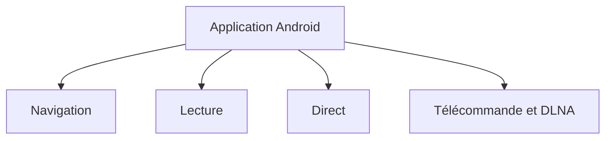

# FongMi/TV

> Video player for Android TV, mobile and tablet, with local files, links and live streams.

## The problem
Watching video content and live streams on Android TV and phone from a single application.

## What it actually does
Very short README, in Chinese. It announces category browsing and multi-site search, playback with speed control, subtitles, danmaku and picture-in-picture, live TV with a program guide, remote control, DLNA, sync and Android Auto. Content sources go through crawling scripts (the CatVodSpider project).

## How it is wired
Not documented: no diagram or architecture provided.

## Trying it
No command documented in the README.

## Cost and gotchas
Free. Installation and the origin of the content sources are not described; check the legality of the sources before any use.

## What it is not
Not a content provider: the application depends on external sources that are not detailed.

## Alternatives
No alternative named in the README (it points to CatVodSpider for the scripts).

## For you
Ignore: a consumer media player, unrelated to data, AI or MLOps, and too little material to judge.
