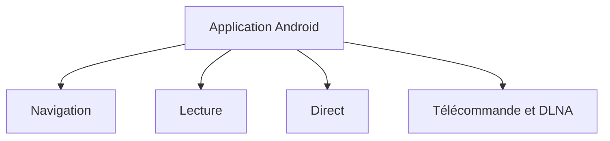

# FongMi/TV

> Lecteur vidéo pour Android TV, mobile et tablette, avec fichiers locaux, liens et direct.

## Le problème
Regarder du contenu vidéo et du direct sur Android TV et téléphone depuis une seule application.

## Ce que ça fait vraiment
README très court, en chinois. Il annonce navigation par catégories et recherche multisites, lecture avec vitesse, sous-titres, danmaku et picture-in-picture, direct avec guide des programmes, télécommande, DLNA, synchronisation et Android Auto. Les sources de contenu passent par des scripts d'exploration (projet CatVodSpider).

## Comment c'est branché
Non documenté : ni diagramme ni architecture fournis.

## Essayer
Aucune commande documentée dans le README.

## Coût et pièges
Gratuit. L'installation et l'origine des sources de contenu ne sont pas décrites ; vérifier la légalité des sources avant tout usage.

## Ce que ce n'est pas
Pas un fournisseur de contenu : l'application dépend de sources externes non détaillées.

## Alternatives
Aucune alternative nommée dans le README (renvoi vers CatVodSpider pour les scripts).

## Pour toi
À ignorer : lecteur multimédia grand public, sans lien avec data, IA ou MLOps, et matière trop mince pour juger.

