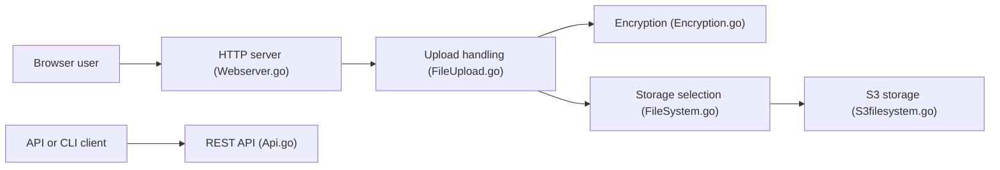

# Forceu/Gokapi

> Self-hosted file-sharing server with expiring links, an alternative to Firefox Send.

## The problem
Sending a large file without leaving it lying around indefinitely at a third party.

## What it actually does
Go server: links that expire after N downloads or N days, accounts with roles, file requests, deduplication, encryption (including end-to-end), local or S3 storage, OpenID Connect, REST API. SQLite or Redis database, setup wizard on first launch.

## How it is wired


## Trying it
```bash
docker run --rm \
  --name gokapi \
  -v gokapi-data:/app/data \
  -v gokapi-config:/app/config \
  -p 127.0.0.1:53842:53842 \
  -e TZ=UTC \
  docker.io/f0rc3/gokapi:latest
```
Then open `http://localhost:53842/setup`.

## Cost and gotchas
Free; 256 MB of RAM minimum. Disk or S3 storage is on you. AGPL-3.0: modifications served over a network must be published.

## What it is not
Not a data/AI tool. The internal wiring is not fully documented (the graph flags it).

## Alternatives
- Firefox Send: the service it aims to be an alternative to (discontinued, judging by the project name).

## For you
Ignore for your line of work: a good file-sharing tool, but outside the data/AI/MLOps watch; keep it only if you have this need internally.
