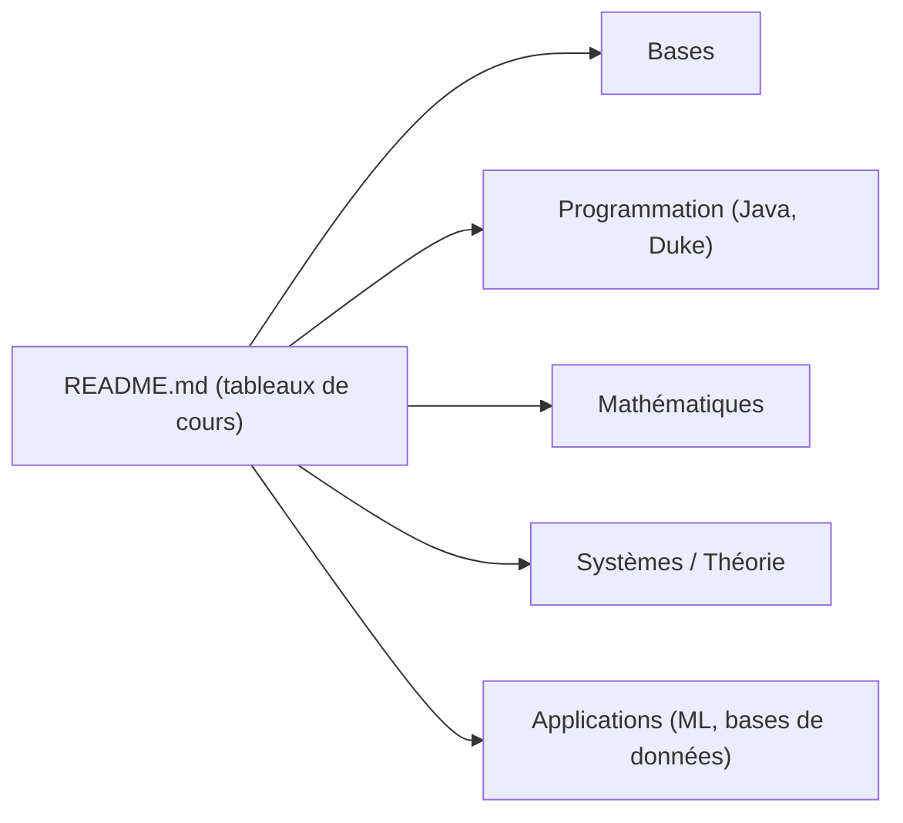

# ForrestKnight/open-source-cs

> List of free courses from recognized universities, equivalent to a bachelor's degree in computer science.

## The problem
Building a coherent computer science path from scattered online courses requires sorting.

## What it actually does
One table per theme (basics, programming, mathematics, systems, theory, applications, Unix). Each row gives the course, the school (Harvard, Duke, MIT, Stanford, Princeton…), the duration, the effort, the frequency and the prerequisites. Includes a Stanford Machine Learning course and mathematics (linear algebra, probability).

## How it is wired

Simplified diagram based on the sheet, no diagram provided.

## Trying it
Nothing to install: open the README and follow the course links.

## Cost and gotchas
Free to follow the courses, but the list has not been updated since June 2025: courses or frequencies may have changed or disappeared. Some courses come from platforms that may require an account.

## What it is not
Not a degree, and general education subjects are excluded. Not a path centered on data or AI: only one ML course and some mathematics courses come close.

## Alternatives
No alternative named in the README.

## For you
Watch: useful to fill gaps in algorithms or mathematics, but to be checked course by course since the list is aging.
