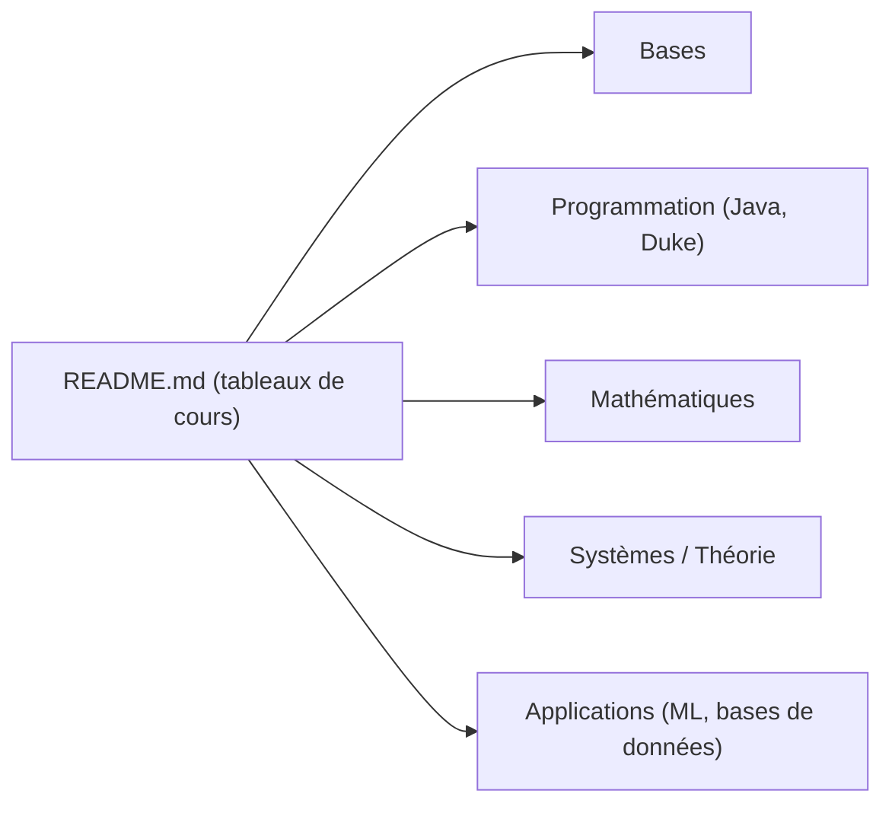

# ForrestKnight/open-source-cs

> Liste de cours gratuits d'universités reconnues, équivalents à un cursus de licence en informatique.

## Le problème
Construire un parcours d'informatique cohérent à partir de cours en ligne dispersés demande du tri.

## Ce que ça fait vraiment
Un tableau par thème (bases, programmation, mathématiques, systèmes, théorie, applications, Unix). Chaque ligne donne le cours, l'école (Harvard, Duke, MIT, Stanford, Princeton…), la durée, l'effort, la fréquence et les prérequis. Inclut un cours de Machine Learning de Stanford et des mathématiques (algèbre linéaire, probabilités).

## Comment c'est branché

Schéma simplifié d'après la fiche, sans diagramme fourni.

## Essayer
Rien à installer : ouvrir le README et suivre les liens des cours.

## Coût et pièges
Gratuit pour suivre les cours, mais la liste n'est plus mise à jour depuis juin 2025 : des cours ou fréquences peuvent avoir changé ou disparu. Certains cours viennent de plateformes pouvant demander un compte.

## Ce que ce n'est pas
Pas un diplôme, et les matières générales sont exclues. Pas un parcours centré sur la data ou l'IA : seuls un cours de ML et des cours de mathématiques s'en rapprochent.

## Alternatives
Aucune alternative nommée dans le README.

## Pour toi
À surveiller : utile pour combler des lacunes en algorithmes ou en mathématiques, mais à vérifier cours par cours puisque la liste vieillit.

