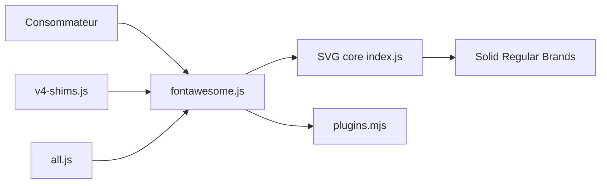

# FortAwesome/Font-Awesome

> Icon library and toolkit for web designers and developers, free version 7.

## The problem
Having consistent icons in an interface without drawing them one by one.

## What it actually does
Provides free icon collections (solid, regular, brands) and a JavaScript runtime that replaces DOM content with SVG. The repository also contains a separate SVG core, bundles (all.js, solid.js…) and shims for version 4. Version 6 is in long-term support, versions 3 to 5 are end-of-life.

## How it is wired

## Trying it
No command documented in this README: it points to the version 7 documentation.

## Cost and gotchas
Free for this Free edition. Versioning departs from SemVer: a minor version can break compatibility, with instructions in UPGRADING.md.

## What it is not
Not the full range: the "Free" label applies to this distribution. A patch never removes an icon, but an icon's design may change. License present but not identified by GitHub.

## Alternatives
No alternative named in the README.

## For you
Adopt it if you build an interface (demo, dashboard): ready-to-use icons; check the license of the files before redistributing.
