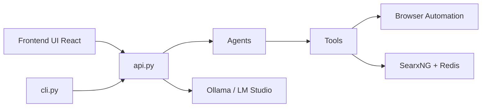

# Fosowl/agenticSeek

> Local agentic assistant (web browsing, code, planning) designed for self-hosted LLMs.

## The problem
Manus-style agentic assistants send data and requests to the cloud, with a recurring API cost.

## What it actually does
Automatic routing to agents (planner, coder, file, browser, casual) with Python, C, Go, Java and Bash interpreters.
Browsing via Selenium (stealth mode) and search via SearxNG + Redis in Docker.
Local providers (Ollama, LM Studio, OpenAI-compatible server) or APIs (OpenAI, Gemini, DeepSeek...).
React web interface (localhost:3000) or CLI; experimental voice.

## How it is wired


## Trying it
```bash
git clone https://github.com/Fosowl/agenticSeek.git
cd agenticSeek
mv .env.example .env
./start_services.sh full
uv run cli.py
```

## Cost and gotchas
Free locally but a 12 GB GPU minimum (14B), 24 GB recommended. First Docker start up to 30 min; ChromeDriver is often out of sync.

## What it is not
A prototype with no roadmap or funding; agent routing often gets it wrong. The stealth mode and the anti-captcha extension raise questions about usage.

## Alternatives
No open source alternative named in the README (Manus cited as a competing service).

## For you
Keep an eye on it: an interesting demonstrator of a 100% local agent, but too fragile and GPL-3.0 for a production building block.
