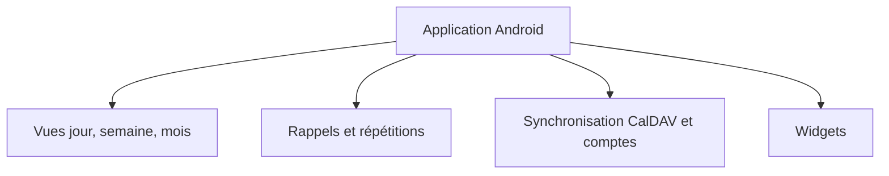

# FossifyOrg/Calendar

> A free Android calendar, with no ads or tracking, with synchronization and widgets.

## The problem
Mainstream calendars show ads, ask for broad permissions and lock your data in with a provider.

## What it actually does
Android calendar application: events with duration, reminders and repetitions, day, week, month, year views, filters, import of holidays and birthdays, widgets, Material themes. It synchronizes with Google Calendar, Outlook, Nextcloud or Exchange. The text is an app store listing description.

## How it is wired
Simplified diagram based on the sheet, no diagram provided.

## Trying it
No documented command: the application is downloaded from the project's links (fossify.org).

## Cost and gotchas
Free, no ads. More than 300 open issues, which leaves a heavy backlog.

## What it is not
Not a tool for developers or for data: a calendar for phones. GPL-3.0 license, to be respected if you reuse the code.

## Alternatives
No alternative named in the README.

## For you
Ignore: a mainstream calendar, unrelated to data, AI or MLOps work, even though it is well maintained by a community.
