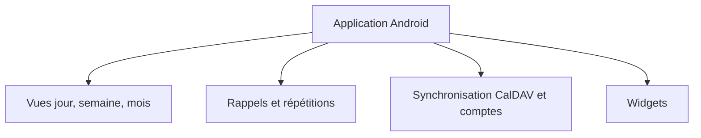

# FossifyOrg/Calendar

> Un agenda Android libre, sans publicité ni pistage, avec synchronisation et widgets.

## Le problème
Les agendas courants affichent des publicités, demandent des permissions larges et enferment les données chez un fournisseur.

## Ce que ça fait vraiment
Application d'agenda Android : événements avec durée, rappels et répétitions, vues jour, semaine, mois, année, filtres, import de jours fériés et d'anniversaires, widgets, thèmes Material. Elle synchronise avec Google Calendar, Outlook, Nextcloud ou Exchange. Le texte est une description de fiche de magasin d'applications.

## Comment c'est branché
Schéma simplifié d'après la fiche, sans diagramme fourni.

## Essayer
Aucune commande documentée : l'application se télécharge depuis les liens du projet (fossify.org).

## Coût et pièges
Gratuit, sans publicité. Plus de 300 tickets ouverts, ce qui laisse un suivi chargé.

## Ce que ce n'est pas
Pas un outil pour développeurs ni pour la data : un agenda pour téléphone. Licence GPL-3.0, à respecter si tu en reprends le code.

## Alternatives
Aucune alternative nommée dans le README.

## Pour toi
À ignorer : agenda grand public, sans rapport avec le travail data, IA ou MLOps, même s'il est bien tenu par une communauté.

