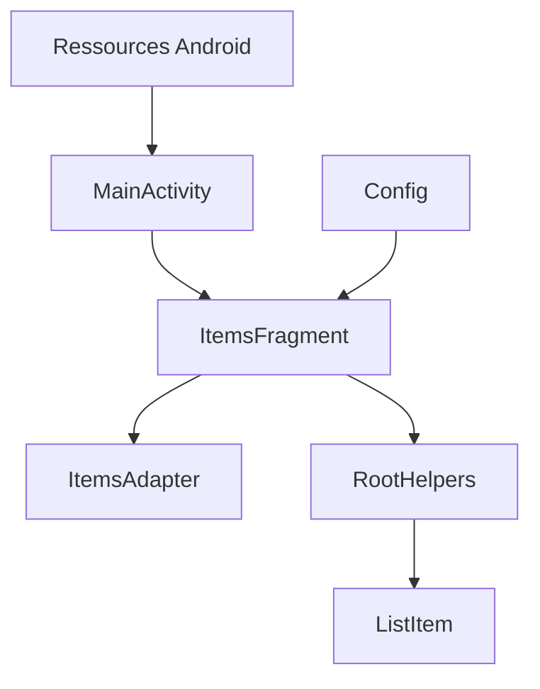

# FossifyOrg/File-Manager

> Free, offline, ad-free Android file manager.

## The problem
Android file managers are often loaded with ads and tracking.

## What it actually does
Browsing, search, sorting, compression, favorites, storage analysis, locking by password, pattern or fingerprint, lightweight text editor, root access, SD card and USB. No Internet access required according to the README. Written in Kotlin.

## How it is wired


## Trying it
```bash
# No command documented in the README (installation through app stores).
```

## Cost and gotchas
Free, GPL-3.0. Android only. The README is promotional text ("DOMINATE", "BLAZING-FAST"); the speed claims are not measured.

## What it is not
Not a backup or cloud sync tool.

## Alternatives
No alternative named in the README.

## For you
Ignore: mainstream Android application, unrelated to a data / AI / MLOps profile.
