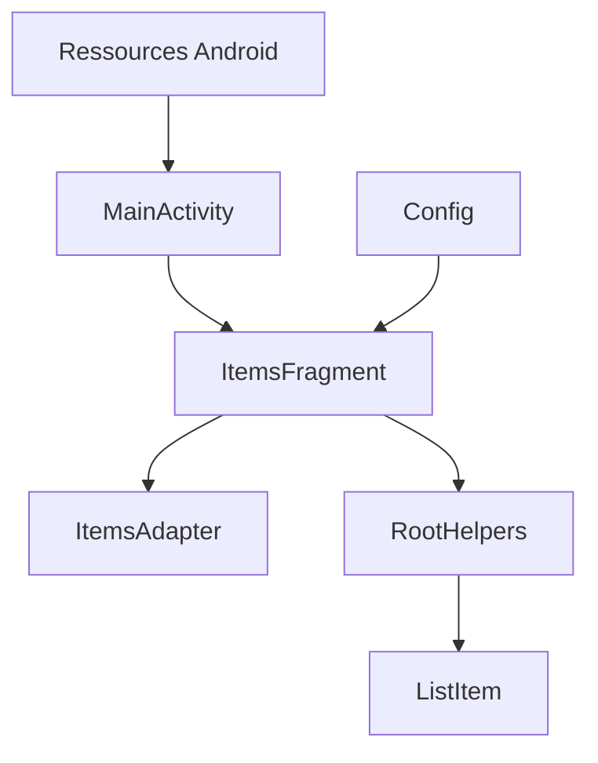

# FossifyOrg/File-Manager

> Gestionnaire de fichiers Android libre, hors ligne et sans publicité.

## Le problème
Les gestionnaires de fichiers Android sont souvent chargés de publicités et de suivi.

## Ce que ça fait vraiment
Navigation, recherche, tri, compression, favoris, analyse du stockage, verrouillage par mot de passe, motif ou empreinte, éditeur de texte léger, accès racine, carte SD et USB. Aucun accès Internet requis d'après le README. Écrit en Kotlin.

## Comment c'est branché


## Essayer
```bash
# Aucune commande documentée dans le README (installation par les magasins d'applications).
```

## Coût et pièges
Gratuit, GPL-3.0. Android uniquement. Le README est du texte promotionnel (« DOMINATE », « BLAZING-FAST ») ; les affirmations de vitesse ne sont pas mesurées.

## Ce que ce n'est pas
Pas un outil de sauvegarde ni de synchronisation cloud.

## Alternatives
Aucune alternative nommée dans le README.

## Pour toi
À ignorer : application Android grand public, sans rapport avec un profil data / IA / MLOps.

