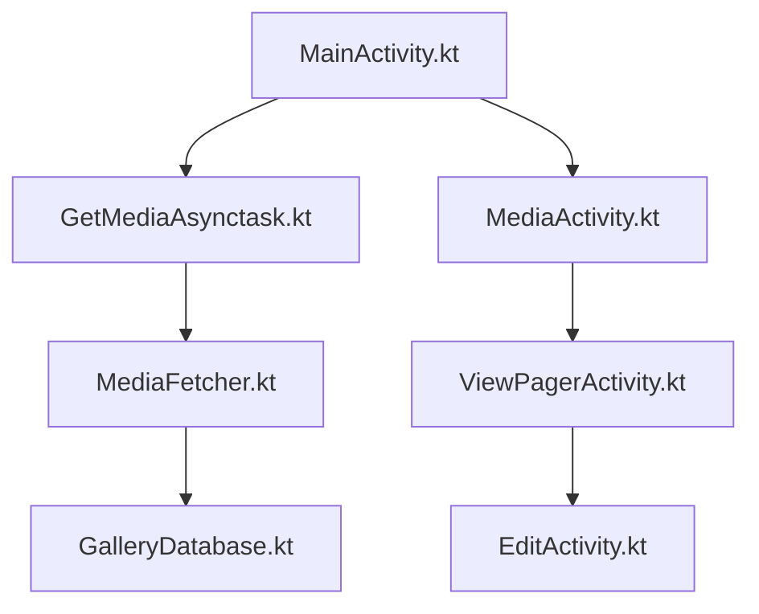

# FossifyOrg/Gallery

> A free, ad-free Android photo and video gallery, with a simple editor and code protection.

## The problem
Mainstream Android galleries ship with ads, needless permissions and exposed EXIF metadata.

## What it actually does
It lists folders then media, with a viewer and an editor (crop, rotate, draw, filters). It strips EXIF metadata, locks with a code, pattern or fingerprint, and keeps a recycle bin. It reads JPEG, JPEG XL, PNG, MP4, MKV, RAW, SVG, GIF and AVIF. A Room database serves as a cache.

## How it is wired


## Trying it
```bash
# Aucune commande documentée : le README renvoie au site fossify.org pour l'installation.
```

## Cost and gotchas
Free, GPL-3.0. 341 open issues. No hidden cost mentioned.

## What it is not
Not a photo library management tool nor AI tagging: it is a local gallery.

## Alternatives
No alternative named in the README.

## For you
Ignore: a mainstream mobile application, outside the data, AI or MLOps scope.
