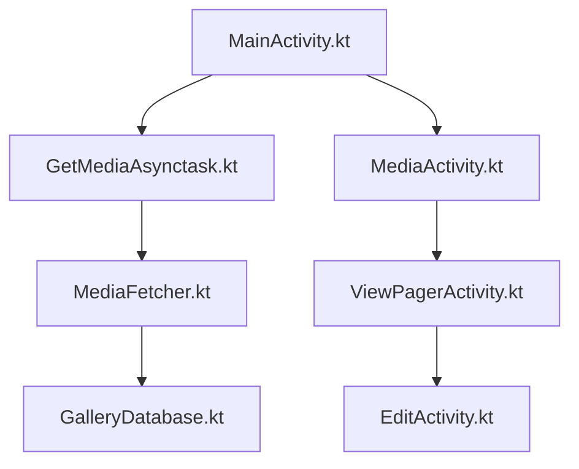

# FossifyOrg/Gallery

> Galerie photo et vidéo Android libre, sans publicité, avec éditeur simple et protection par code.

## Le problème
Les galeries Android courantes embarquent publicité, permissions inutiles et métadonnées EXIF exposées.

## Ce que ça fait vraiment
Elle liste dossiers puis médias, avec un visualiseur et un éditeur (recadrage, rotation, dessin, filtres). Elle supprime les métadonnées EXIF, verrouille par code, motif ou empreinte, et garde une corbeille. Elle lit JPEG, JPEG XL, PNG, MP4, MKV, RAW, SVG, GIF et AVIF. Une base Room sert de cache.

## Comment c'est branché


## Essayer
```bash
# Aucune commande documentée : le README renvoie au site fossify.org pour l'installation.
```

## Coût et pièges
Gratuit, GPL-3.0. 341 issues ouvertes. Aucun coût caché mentionné.

## Ce que ce n'est pas
Pas un outil de gestion de photothèque ni d'étiquetage par IA : c'est une galerie locale.

## Alternatives
Aucune alternative nommée dans le README.

## Pour toi
À ignorer : application mobile grand public, hors du périmètre data, IA ou MLOps.

