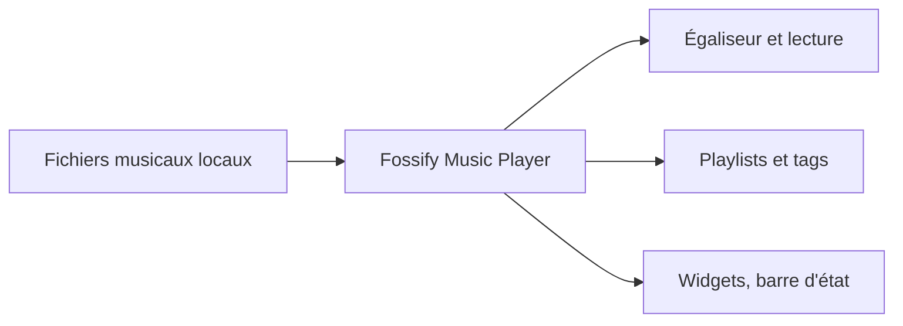

# FossifyOrg/Music-Player

> Offline, ad-free Android music player with equalizer, sleep timer and playlists.

## The problem
Mobile music players impose ads, accounts or unnecessary permissions.

## What it actually does
It plays local music without a connection, with a preset equalizer, sleep timer, playlist management, tag editing, widgets, dark and custom themes, and controls from the status bar or headphones.

## How it is wired
Simplified diagram based on the sheet, no diagram provided.



## Trying it
```bash
# Aucune commande dans le README : installation depuis une boutique d'applications.
# Site et code : https://www.fossify.org et https://www.github.com/FossifyOrg
```

## Cost and gotchas
Free, ad-free, and according to the README no data collection. No cost pitfall reported.

## What it is not
No streaming or online service. The README is promotional and describes neither architecture nor build procedure.

## Alternatives
No alternative cited in the README.

## For you
Ignore: a simple Android player unrelated to data, AI or MLOps work.
