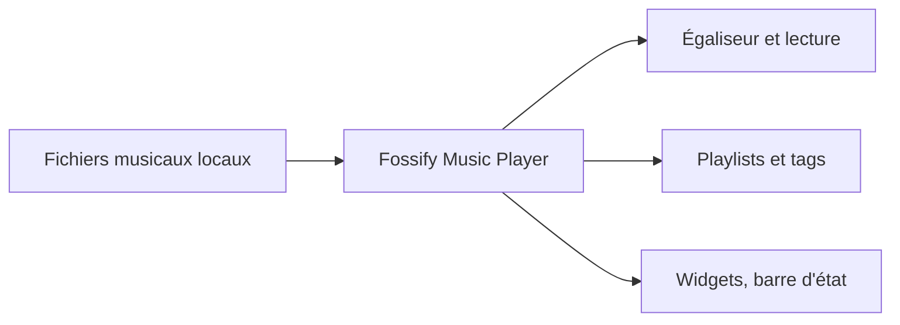

# FossifyOrg/Music-Player

> Lecteur de musique Android hors ligne, sans publicité, avec égaliseur, minuterie et playlists.

## Le problème
Les lecteurs musicaux mobiles imposent publicités, comptes ou permissions superflues.

## Ce que ça fait vraiment
Il lit la musique locale sans connexion, avec égaliseur à préréglages, minuterie de sommeil, gestion de playlists, édition des tags, widgets, thèmes sombre et personnalisés et commandes depuis la barre d'état ou les écouteurs.

## Comment c'est branché
Schéma simplifié d'après la fiche, sans diagramme fourni.



## Essayer
```bash
# Aucune commande dans le README : installation depuis une boutique d'applications.
# Site et code : https://www.fossify.org et https://www.github.com/FossifyOrg
```

## Coût et pièges
Gratuit, sans publicité, et selon le README sans collecte de données. Aucun piège de coût signalé.

## Ce que ce n'est pas
Pas de streaming ni de service en ligne. Le README est promotionnel et ne décrit ni architecture ni procédure de build.

## Alternatives
Aucune alternative citée dans le README.

## Pour toi
Ignorer : simple lecteur Android sans lien avec un travail data, IA ou MLOps.

