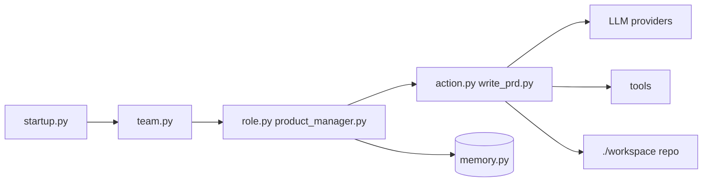

# FoundationAgents/MetaGPT

> Python-based framework for simulating a software team (project manager, architect, engineer) based on a single sentence.

## The problem
Moving from a requirement of a single line to specifications, design, and code requires coordinating multiple steps, which individual agents struggle to manage effectively.

## What it actually does
Philosophy `Code = SOP(Team)`: A team (`team.py`) of roles (e.g., product manager, architect, project manager, engineer, QA) executes atomic actions (`action.py`, `write_prd.py`…) according to written procedures.

Output: user stories, competitive analysis, requirements, data structures, APIs, documents, and a repository generated in `./workspace`.

Around: LLM adapters (`provider/` : OpenAI, Azure, Anthropic, Ollama…), memory, RAG (BM25, FAISS, Chroma), tools (browser, shell, git), Data Interpreter for data analysis, extensions (Stanford Town, Werewolf, AFLOW).

## How it is wired


## Trying it
```bash
pip install --upgrade metagpt
metagpt --init-config
metagpt "Create a 2048 game"
```

## Cost and gotchas
API key for the LLM is located in `~/.metagpt/config2.yaml`; you are responsible for providing it. A complete project involves chaining many calls. Python 3.9 to 3.11 is required; Node.js and pnpm are also required.

## What it is not
Not a reliable platform for creating real applications: the flagship demo is a 2048 game. The framework is extensive (environments, search extensions): getting started requires more than just `pip install`.

## Alternatives
No alternative is specified in the README file.

## For you
To be aware of: The Data Interpreter is the only component directly useful for a data profile.
