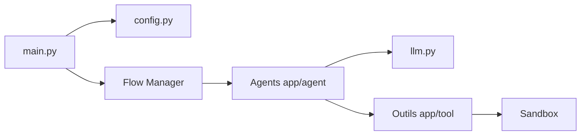

# FoundationAgents/OpenManus

> Open source Python framework for general-purpose agents driven by a language model, with no invitation code.

## The problem
Proprietary general-purpose agents are invitation-only; this project offers an alternative you run yourself.

## What it actually does
A terminal launcher (`main.py`, `run_mcp.py`, `run_flow.py`) reads a `config.toml`, loads an agent (general, data analysis, browser, SWE), goes through an LLM adapter to the configured API and calls tools (bash, Python execution, search, browser via Browser Use, visualization). A Docker sandbox exists; the multi-agent version is described as unstable by the README.

## How it is wired


## Trying it
```bash
uv venv --python 3.12
uv pip install -r requirements.txt
cp config/config.example.toml config/config.toml
python main.py
```

## Cost and gotchas
LLM API key at your expense (example gpt-4o). The cloud browser requires `BROWSER_USE_API_KEY`. Multi-agent mode is unstable.

## What it is not
It is not a guarantee of results equivalent to Manus. The architecture report probably predates the README (navigation: Browser Use CLI by default).

## Alternatives
No alternative named in the README (mentions Manus and OpenManus-RL).

## For you
Watch: interesting for studying a tool-using agent, but a prototype whose LLM bill and stability remain to be measured.
