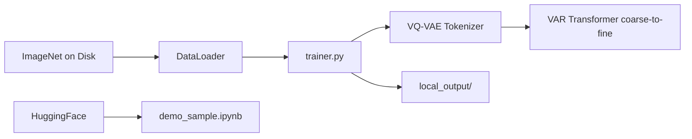

# FoundationVision/VAR

> Code and weights of VAR, autoregressive image generation by next-scale prediction (NeurIPS 2024).

## The problem
Autoregressive image models that predict token by token in raster-scan order lagged behind diffusion models in quality.

## What it actually does
VAR predicts the image from coarse to fine, resolution by resolution, with a multi-scale VQ-VAE tokenizer and a Transformer. The repository provides training on ImageNet 256 and 512 (`train.py` via `torchrun`, automatic checkpoint resumption), models from 310M to 2.3B parameters on Hugging Face (FID 1.80 at 256 px) and a sampling notebook. The sampling script is announced as "later".

## How it is wired


## Trying it
```bash
pip3 install -r requirements.txt
torchrun --nproc_per_node=8 --nnodes=... --node_rank=... --master_addr=... --master_port=... train.py --depth=16 --bs=768 --ep=200 --fp16=1 --alng=1e-3 --wpe=0.1
tensorboard --logdir=local_output/
```

## Cost and gotchas
Training is designed for 8 GPUs per node and several nodes, with ImageNet to download. Inference alone goes through the notebook and the VAE `vae_ch160v4096z32.pth`.

## What it is not
Not a text-to-image generator: this repository covers ImageNet class-conditional generation; text-to-image is only in the online demo.

## Alternatives
- FoundationVision/Infinity: bitwise follow-up for high resolution.
- mit-han-lab/hart: hybrid autoregressive transformer for more efficient generation.

## For you
Worth watching: a flagship paper that launched a line of work (table of derivatives provided), useful for understanding autoregressive modeling in vision, but reproducing it requires a GPU cluster.
