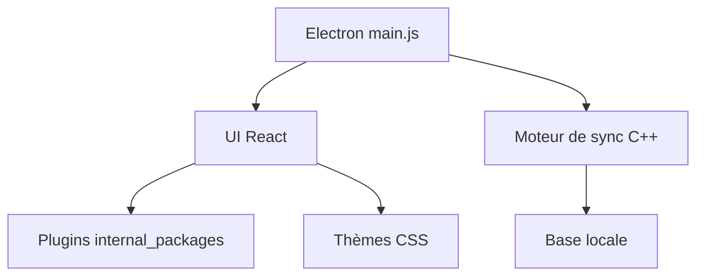

# Foundry376/Mailspring

> Extensible desktop email client, successor to Nylas Mail, with a C++ sync engine.

## The problem
Mail clients are heavy, battery-hungry, or send your credentials to a third party's cloud.

## What it actually does
Electron/React application in TypeScript with a C++ sync engine (Mailcore2) launched locally. Features: unified inbox, send later, reminders, rules, templates, plugins and CSS themes. The paid Pro version adds link tracking, read receipts and analytics. The features run in the client; the README claims credentials do not leave for the cloud. Translations supported.

## How it is wired


## Trying it
```bash
export npm_config_arch=x64
npm install
npm start
npm run-script build
```

## Cost and gotchas
Free; subscription for Pro. The architecture described by the graph is sparsely detailed. The plugin store is announced as "coming soon": you must install them by hand.

## What it is not
It is not a service: it is a client to install. It is not entirely free.

## Alternatives
The README cites Nylas Mail, from which it derives.

## For you
Ignore: a messaging application with no link to your data/AI/MLOps domain.
