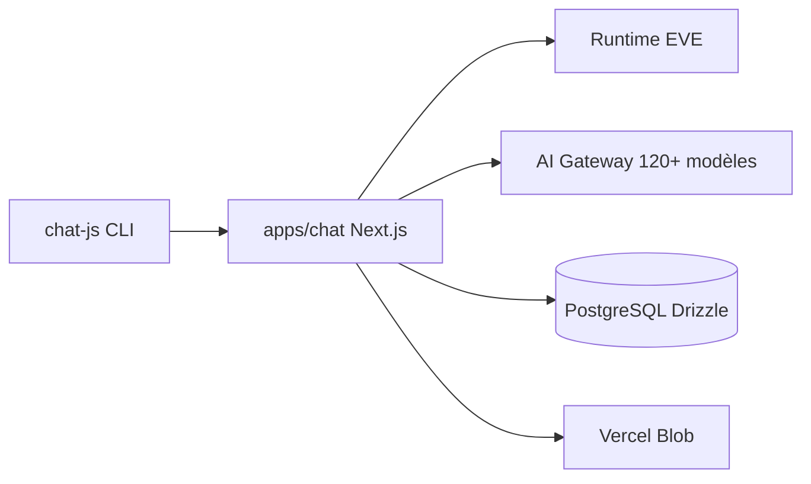

# FranciscoMoretti/chatjs

> Next.js foundation for building an AI chat app with auth, models, streaming and tools.

## The problem
Every new AI chat app rewrites authentication, streaming, attachments and conversation sharing.

## What it actually does
A CLI generates a Next.js app configured by `chat.config.ts`. It gives access to more than 120 models via the AI Gateway, with auth (GitHub, Google, anonymous), attachments, conversation branches, sharing, web search, image generation, code execution and MCP. The conversation runtime is EVE, with PostgreSQL for the database.

## How it is wired
Simplified diagram based on the sheet, no diagram provided.


## Trying it
```bash
npx chat-js@alpha create my-app
```

## Cost and gotchas
Model access keys are at your expense, and so are Vercel services (Gateway, Blob). The CLI is in alpha. Local development requires Node 24+, Bun and isolated databases.

## What it is not
The README states that the EVE runtime alone does not establish that the product is production-ready: deletion at providers and guest hosting remain to be validated. Old conversations are not imported.

## Alternatives
No alternative named in the README.

## For you
Worth watching: useful for quickly prototyping an LLM chat interface, but in alpha and coupled to the Vercel ecosystem.
