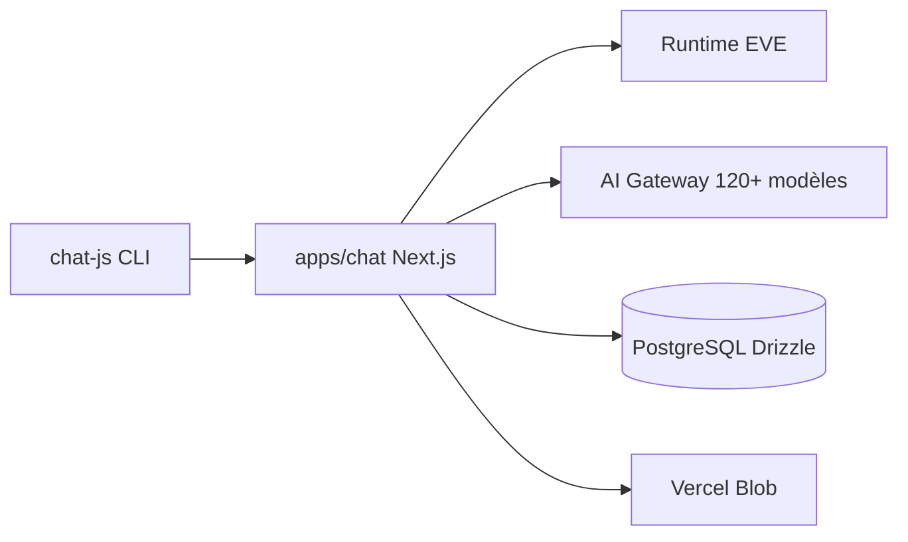

# FranciscoMoretti/chatjs

> Socle Next.js pour construire une appli de chat IA avec auth, modèles, streaming et outils.

## Le problème
Chaque nouvelle appli de chat IA réécrit l'authentification, le streaming, les pièces jointes et le partage de conversations.

## Ce que ça fait vraiment
Un CLI génère une appli Next.js configurée par `chat.config.ts`. Elle donne accès à plus de 120 modèles via l'AI Gateway, avec auth (GitHub, Google, anonyme), pièces jointes, branches de conversation, partage, recherche web, génération d'images, exécution de code et MCP. Le runtime de conversation est EVE, avec PostgreSQL pour la base.

## Comment c'est branché
Schéma simplifié d'après la fiche, sans diagramme fourni.


## Essayer
```bash
npx chat-js@alpha create my-app
```

## Coût et pièges
Clés d'accès aux modèles à ta charge, et services Vercel (Gateway, Blob). Le CLI est en alpha. Le dev local demande Node 24+, Bun et des bases isolées.

## Ce que ce n'est pas
Le README précise que le runtime EVE seul n'établit pas que le produit soit prêt pour la production : la suppression chez les fournisseurs et l'hébergement invités restent à valider. Les anciennes conversations ne sont pas importées.

## Alternatives
Aucune alternative nommée dans le README.

## Pour toi
À surveiller : utile pour prototyper une interface de chat LLM rapidement, mais en alpha et couplé à l'écosystème Vercel.

