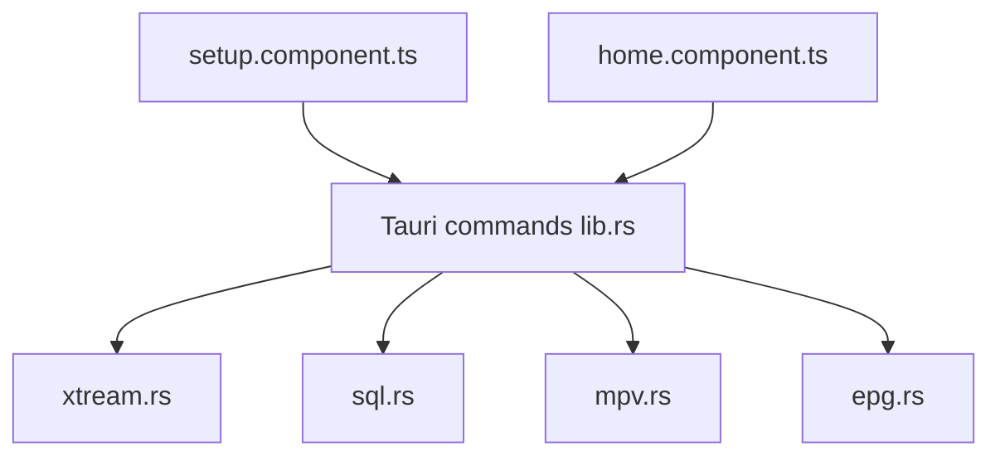

# Fredolx/open-tv

> Fast desktop IPTV player to import your M3U or Xtream channels, search them and record them.

## The problem
IPTV players are slow, loaded with ads and poorly suited to a large channel list.

## What it actually does
Fred TV imports channels from an M3U file or link or an Xtream account, and handles multiple sources, favorites, custom channels and their sharing, instant search and recording during playback. From the code (Angular and Tauri), the Rust commands read the SQL database and launch mpv for playback. Re-streaming to other devices, remote-control operation.

## How it is wired


## Trying it
```bash
brew install mpv ffmpeg yt-dlp
sudo apt install mpv ffmpeg yt-dlp
docker run --rm -it --net=host --env="DISPLAY" ghcr.io/fredolx/open-tv:latest
```

## Cost and gotchas
Free. It depends on mpv, ffmpeg and yt-dlp, already included on Windows and in the Flatpak. The README prefers the published releases over Docker. You must provide your own IPTV sources. A single developer, who asks for donations.

## What it is not
It is not a channel provider. The name "Fred TV" is the project's own, unrelated to other software of the same name.

## Alternatives
No alternative named in the README.

## For you
Ignore: a consumer media player unrelated to data or AI, with a single maintainer.
