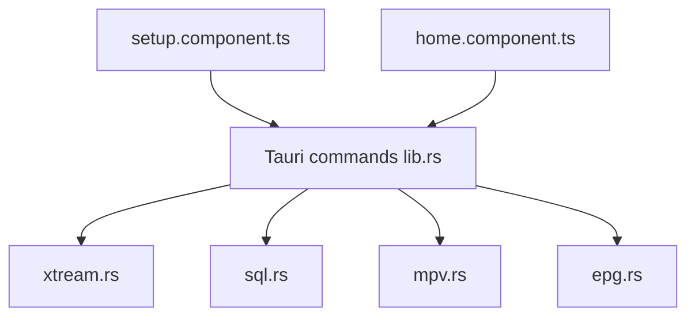

# Fredolx/open-tv

> Lecteur IPTV de bureau, rapide, pour importer ses chaînes M3U ou Xtream, les chercher et les enregistrer.

## Le problème
Les lecteurs IPTV sont lents, chargés d'annonces et peu adaptés à une grosse liste de chaînes.

## Ce que ça fait vraiment
Fred TV importe des chaînes depuis un fichier ou lien M3U ou un compte Xtream, gère plusieurs sources, les favoris, des chaînes personnalisées et leur partage, la recherche instantanée et l'enregistrement pendant la lecture. D'après le code (Angular et Tauri), les commandes Rust lisent la base SQL et lancent mpv pour la lecture. Re-diffusion vers d'autres appareils, pilotage à la télécommande.

## Comment c'est branché


## Essayer
```bash
brew install mpv ffmpeg yt-dlp
sudo apt install mpv ffmpeg yt-dlp
docker run --rm -it --net=host --env="DISPLAY" ghcr.io/fredolx/open-tv:latest
```

## Coût et pièges
Gratuit. Il dépend de mpv, ffmpeg et yt-dlp, déjà inclus sous Windows et dans le Flatpak. Le README préfère les versions publiées au Docker. Il faut fournir tes propres sources IPTV. Un seul développeur, qui demande des dons.

## Ce que ce n'est pas
Ce n'est pas un fournisseur de chaînes. Le nom « Fred TV » est celui du projet, sans lien avec d'autres logiciels du même nom.

## Alternatives
Aucune alternative nommée dans le README.

## Pour toi
À ignorer : lecteur multimédia grand public sans rapport avec la data ou l'IA, avec un mainteneur unique.

