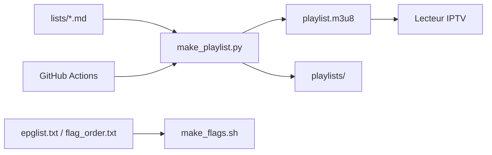

# Free-TV/IPTV

> M3U playlist of free TV channels from around the world, for IPTV players.

## The problem
Finding streams of genuinely free, up-to-date, good-quality channels, without any mix-in of paid offerings.

## What it actually does
Markdown files per group in `lists/` are converted into `playlist.m3u8` by `make_playlist.py`. Only lines whose URL starts with `[>]` are kept. Markers flag SD, geo-blocked or YouTube channels. `make_flags.sh` handles the flags, and GitHub workflows test and regenerate the playlist. Philosophy: few channels, one URL per channel, free and mainstream.

## How it is wired

## Trying it
Point the IPTV player to `https://raw.githubusercontent.com/Free-TV/IPTV/master/playlist.m3u8`. No other command is documented.

## Cost and gotchas
Free, with no declared license: reuse to be clarified. Streams depend on third-party providers and may break or be geo-blocked. Only edit the `.md` files in a PR.

## What it is not
It is not a stream host: the repository broadcasts nothing, it lists URLs. No control over local legality.

## Alternatives
One stream source is cited in the README: `iptv-org/iptv` (`streams` folder).

## For you
Ignore: a leisure list with no data / AI use, and no declared license.
