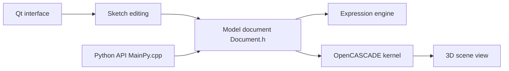

# FreeCAD/FreeCAD

> Open source parametric 3D modeler for designing objects, from mechanics to architecture.

## The problem
Designing 3D objects that can be modified by changing parameters in the model's history.

## What it actually does
Constrained 2D sketches serving as the basis for 3D solids, manufacturing drawings, and various workbenches including FEM, BIM and CAM. Built on OpenCASCADE (geometry kernel), Coin3D (3D scene), Qt (interface) and a Python API for scripts and macros.

## How it is wired

## Trying it
No command documented in the README: download the packages from the releases pages, or build following the Developers Handbook.

## Cost and gotchas
Free. More than 4,000 open issues. For any bug report, the README asks for an example file and a reproduction macro.

## What it is not
Not a data/AI tool. LGPL-2.1: license obligations if you embed the code.

## Alternatives
No alternative named in the README.

## For you
Ignore for your line of work; useful only if you design physical parts (enclosures, mounts) for AI hardware.
