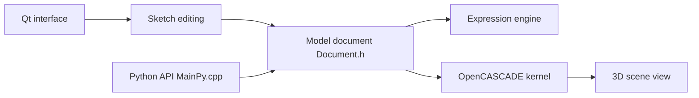

# FreeCAD/FreeCAD

> Modeleur 3D paramétrique open source pour la conception d'objets, de la mécanique à l'architecture.

## Le problème
Concevoir des objets en 3D que l'on peut modifier en changeant des paramètres de l'historique du modèle.

## Ce que ça fait vraiment
Esquisses 2D contraintes servant de base à des solides 3D, plans de fabrication, ateliers (workbenches) variés dont FEM, BIM et CAM. S'appuie sur OpenCASCADE (noyau géométrique), Coin3D (scène 3D), Qt (interface) et une API Python pour les scripts et macros.

## Comment c'est branché

## Essayer
Aucune commande documentée dans le README : télécharger les paquets des pages de versions, ou compiler d'après le Developers Handbook.

## Coût et pièges
Gratuit. Plus de 4 000 issues ouvertes. Le README demande, pour tout rapport de bug, un fichier d'exemple et une macro de reproduction.

## Ce que ce n'est pas
Pas un outil data/IA. LGPL-2.1 : obligations de licence si tu intègres le code.

## Alternatives
Aucune alternative nommée dans le README.

## Pour toi
À ignorer pour ton métier ; utile seulement si tu conçois des pièces physiques (boîtiers, supports) pour du matériel IA.

