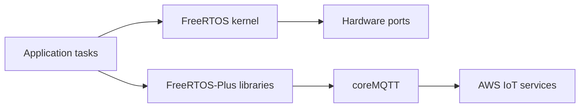

# FreeRTOS/FreeRTOS

> Real-time kernel for microcontrollers, with networking, MQTT and AWS IoT libraries and demo projects.

## The problem
An embedded system must schedule tasks with guaranteed deadlines on tiny hardware.

## What it actually does
Umbrella repository: the kernel (`FreeRTOS/Source`, submodule), demos per board and compiler (`FreeRTOS/Demo`), and libraries (`FreeRTOS-Plus/Source`): TCP, coreMQTT, coreHTTP, OTA, Device Shadow, Jobs, Defender. CBMC proofs in `Test/CBMC/proofs`.

## How it is wired


## Trying it
```bash
git clone https://github.com/FreeRTOS/FreeRTOS.git --recurse-submodules
git submodule update --init --recursive
```

## Cost and gotchas
Free. Submodules are required (the GitHub ZIP is incomplete); on Windows, symbolic links must be enabled. The AWS demos assume an AWS account.

## What it is not
Not an embedded Linux: no file system or MMU assumed. Not an ML tool, even for edge inference.

## Alternatives
No alternative named in the README.

## For you
Ignore unless you have an embedded AI project on a microcontroller: the repository does not address your profile.
