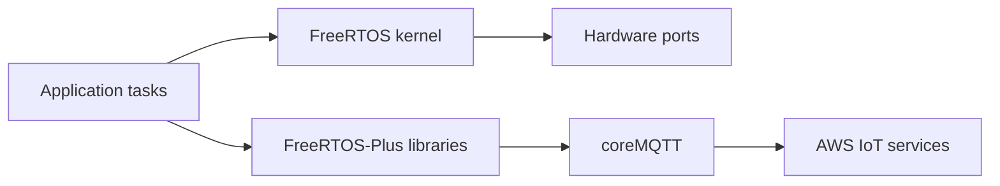

# FreeRTOS/FreeRTOS

> Noyau temps réel pour microcontrôleurs, avec bibliothèques réseau, MQTT et AWS IoT et projets de démo.

## Le problème
Un système embarqué doit ordonnancer des tâches avec des délais garantis sur du matériel minuscule.

## Ce que ça fait vraiment
Dépôt parapluie : le noyau (`FreeRTOS/Source`, sous-module), des démos par carte et compilateur (`FreeRTOS/Demo`), et des bibliothèques (`FreeRTOS-Plus/Source`) : TCP, coreMQTT, coreHTTP, OTA, Device Shadow, Jobs, Defender. Preuves CBMC dans `Test/CBMC/proofs`.

## Comment c'est branché


## Essayer
```bash
git clone https://github.com/FreeRTOS/FreeRTOS.git --recurse-submodules
git submodule update --init --recursive
```

## Coût et pièges
Gratuit. Sous-modules obligatoires (le ZIP GitHub est incomplet) ; sous Windows, liens symboliques à activer. Les démos AWS supposent un compte AWS.

## Ce que ce n'est pas
Pas un Linux embarqué : pas de système de fichiers ni de MMU supposés. Pas un outil ML, même pour de l'inférence en périphérie.

## Alternatives
Aucune alternative nommée dans le README.

## Pour toi
À ignorer sauf projet d'IA embarquée sur microcontrôleur : le dépôt n'adresse pas ton profil.

