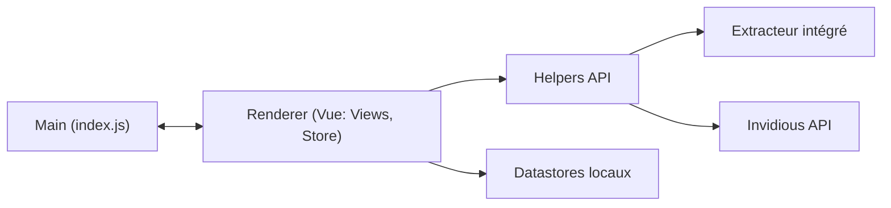

# FreeTubeApp/FreeTube

> Open-source, privacy-focused desktop YouTube player, for watching without ads or an account.

## The problem
YouTube sets cookies, tracks you and serves ads, and requires an account to subscribe.

## What it actually does
An Electron application with a built-in extractor (or the Invidious API as an option). It uses no official API. Subscriptions, playlists and history stay stored locally. It supports SponsorBlock, DeArrow, subscription profiles, an external player, a mini player and themes. The renderer is in Vue, with an Electron main process.

## How it is wired

## Trying it
The README points to the downloads (GitHub Releases, official site, Flatpak on Flathub); no command appears in it.

## Cost and gotchas
Free, no account. The README recommends a VPN or Tor: YouTube still sees the video requests. Automatic (nightly) builds require a GitHub account and come with no guarantee. "Beta" status. AGPL-3.0 license.

## What it is not
Not a data analysis or download tool. It does not guarantee anonymity.

## Alternatives
No alternative cited in the README (Invidious serves as a data source, not a replacement).

## For you
Ignore: a consumer application with no use for a data or AI pipeline; the AGPL license only matters if you plan to reuse its code.
