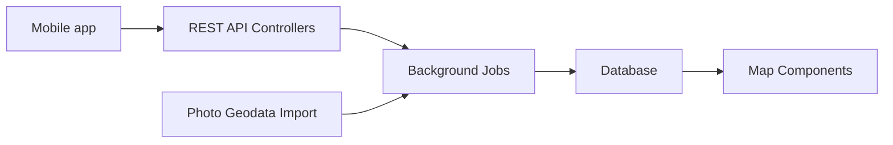

# Freika/dawarich

> Self-hosted web application to replace Google's location history, aimed at individuals.

## The problem
Google Timeline stores your location history on their side; you want to keep it, visualize it and analyze it yourself.

## What it actually does
Rails application: location tracking (mobile apps), map with heatmap and lines, trips, statistics by country and city, family sharing, import (Google, OwnTracks, GPX, Strava, Immich), GeoJSON/GPX export. Heavy tasks go through Sidekiq; data is stored in PostgreSQL.

## How it is wired


## Trying it
```bash
docker compose -f docker/docker-compose.yml up
# puis http://localhost:3000
```

## Cost and gotchas
Free when self-hosted. The README advises against automatic updates: back up before each update. Default demo credentials must be changed.

## What it is not
Not stable: "under active development, breaking changes". A paid cloud version exists elsewhere.

## Alternatives
No alternative named in the README.

## For you
Keep an eye on it: nice for a personal location-data project, but with no direct link to your line of work.
