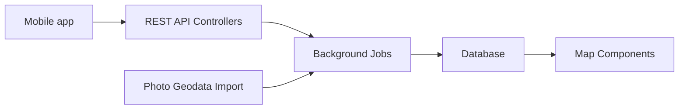

# Freika/dawarich

> Application web auto-hébergée pour remplacer l'historique de position Google, destinée aux particuliers.

## Le problème
Google Timeline stocke ton historique de déplacements chez eux ; tu veux le garder, le visualiser et l'analyser toi-même.

## Ce que ça fait vraiment
Application Rails : suivi de position (apps mobiles), carte avec heatmap et lignes, voyages, statistiques par pays et ville, partage familial, import (Google, OwnTracks, GPX, Strava, Immich), export GeoJSON/GPX. Les tâches lourdes passent par Sidekiq ; les données sont dans PostgreSQL.

## Comment c'est branché


## Essayer
```bash
docker compose -f docker/docker-compose.yml up
# puis http://localhost:3000
```

## Coût et pièges
Gratuit en auto-hébergement. Le README déconseille les mises à jour automatiques : sauvegarder avant chaque mise à jour. Identifiants de démo par défaut à changer.

## Ce que ce n'est pas
Pas stable : « sous développement actif, changements cassants ». Une version cloud payante existe ailleurs.

## Alternatives
Aucune alternative nommée dans le README.

## Pour toi
À surveiller : sympathique pour un projet perso de données de localisation, mais sans lien direct avec ton métier.

