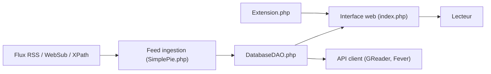

# FreshRSS/FreshRSS

> Self-hosted, multi-user RSS aggregator for reading your feeds from the web or a mobile app.

## The problem
Following dozens of blogs and sites without depending on a reader hosted by a third party.

## What it actually does
Fetches and parses feeds (SimplePie), stores them in a database (SQLite, PostgreSQL, MariaDB or MySQL) and exposes them through a web interface and an API for external clients (Google Reader and Fever). Other features: WebSub push notifications, XPath extraction for sites without feeds, JSON support, labels, sharing via HTML, RSS or OPML, OPML import/export, several login modes (form, HTTP, OpenID Connect), a CLI and extensions.

## How it is wired

## Trying it
No command in the README; manual installation in seven steps: get the code via git or an archive, expose only the ./p/ folder to the web, give the web server write access to ./data/, then follow the installation in the browser (or the CLI).

## Cost and gotchas
Free, AGPL-3.0. Requires a web server (Apache 2.4+ recommended), PHP 8.1+ and a database. The ./data/ folder holds personal data: never expose it. The `edge` branch receives security fixes first, the `latest` branch receives fewer of them.

## What it is not
Not a hosted service: self-hosting and maintenance are on you. The Fever client is "limited, less efficient, less secure" according to the README.

## Alternatives
Kriss Feed and Leed, cited in the README.

## For you
Adopt it if you do your monitoring through RSS feeds: lightweight, multi-user, with an API for mobile clients; the AGPL imposes nothing for personal use.
