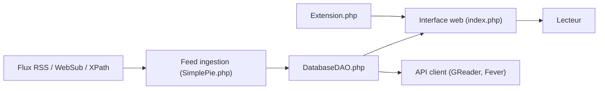

# FreshRSS/FreshRSS

> Agrégateur RSS auto-hébergé, multi-utilisateur, pour lire ses flux depuis le web ou une application mobile.

## Le problème
Suivre des dizaines de blogs et sites sans dépendre d'un lecteur hébergé par un tiers.

## Ce que ça fait vraiment
Récupère et analyse des flux (SimplePie), les stocke en base (SQLite, PostgreSQL, MariaDB ou MySQL) et les expose dans une interface web et par API pour clients externes (Google Reader et Fever). Autres fonctions : notifications push WebSub, extraction par XPath pour des sites sans flux, support JSON, étiquettes, partage par HTML, RSS ou OPML, import/export OPML, plusieurs modes de connexion (formulaire, HTTP, OpenID Connect), une CLI et des extensions.

## Comment c'est branché

## Essayer
Aucune commande dans le README ; installation manuelle en sept étapes : récupérer le code par git ou archive, exposer seulement le dossier ./p/ au web, donner l'écriture sur ./data/ au serveur web, puis suivre l'installation dans le navigateur (ou la CLI).

## Coût et pièges
Gratuit, AGPL-3.0. Il faut un serveur web (Apache 2.4+ recommandé), PHP 8.1+ et une base. Le dossier ./data/ contient les données personnelles : ne jamais l'exposer. La branche `edge` reçoit les corrections de sécurité en premier, la branche `latest` en reçoit moins.

## Ce que ce n'est pas
Pas un service hébergé : l'auto-hébergement et la maintenance sont à ta charge. Le client Fever est « limité, moins efficace, moins sûr » d'après le README.

## Alternatives
Kriss Feed et Leed, cités dans le README.

## Pour toi
À adopter si tu fais ta veille par flux RSS : léger, multi-utilisateur, avec API pour clients mobiles ; l'AGPL n'impose rien en usage personnel.

