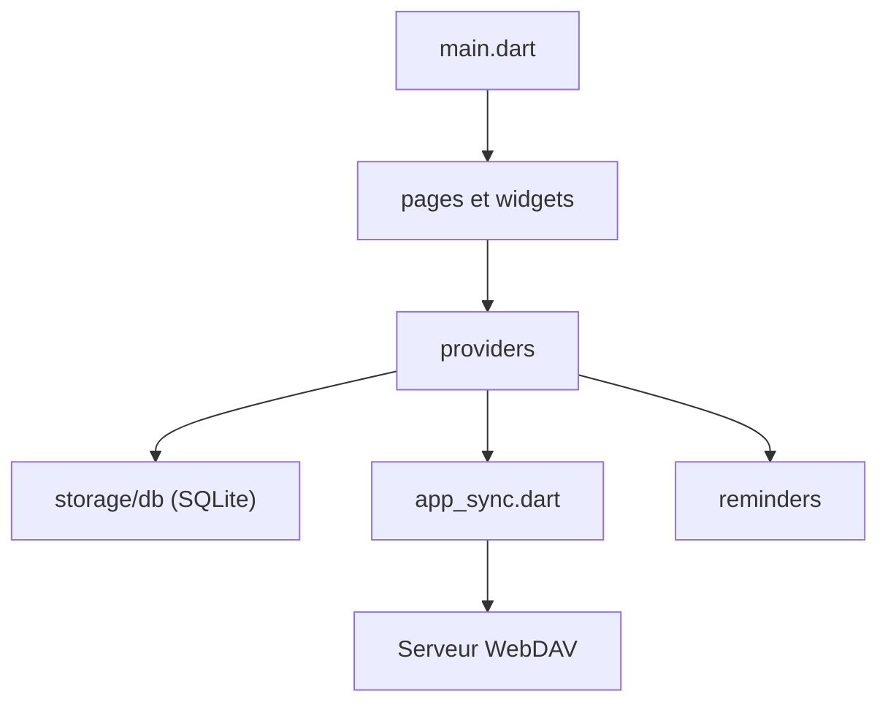

# FriesI23/mhabit

> Cross-platform, offline habit tracker with WebDAV sync, for those who want to keep their data.

## The problem
Habit apps impose an account, ads or a proprietary cloud, and often only count streaks of days.

## What it actually does
A Flutter application for Android, iOS, macOS, Windows and Linux. It computes a consistency score with progress curves, stores everything in SQLite and syncs over WebDAV (Nextcloud, Koofr). It handles reminders, themes, JSON import and export, and migrates from Loop Habit Tracker.

## How it is wired


## Trying it
```bash
brew tap FriesI23/brew-repo
brew install table-habit
flatpak install flathub io.github.friesi23.mhabit
git clone https://github.com/FriesI23/mhabit.git
cd mhabit
make bootstrap
```

## Cost and gotchas
Free, Apache-2.0, no ads or announced telemetry. To sync, you need your own WebDAV server. 96 open issues.

## What it is not
Not a team or enterprise productivity tool: a personal tracker. Sync is not a service provided.

## Alternatives
- Loop Habit Tracker: the app whose data mhabit can import.

## For you
Ignore for work: useful for personal use, but nothing for a data / AI / MLOps profile.
