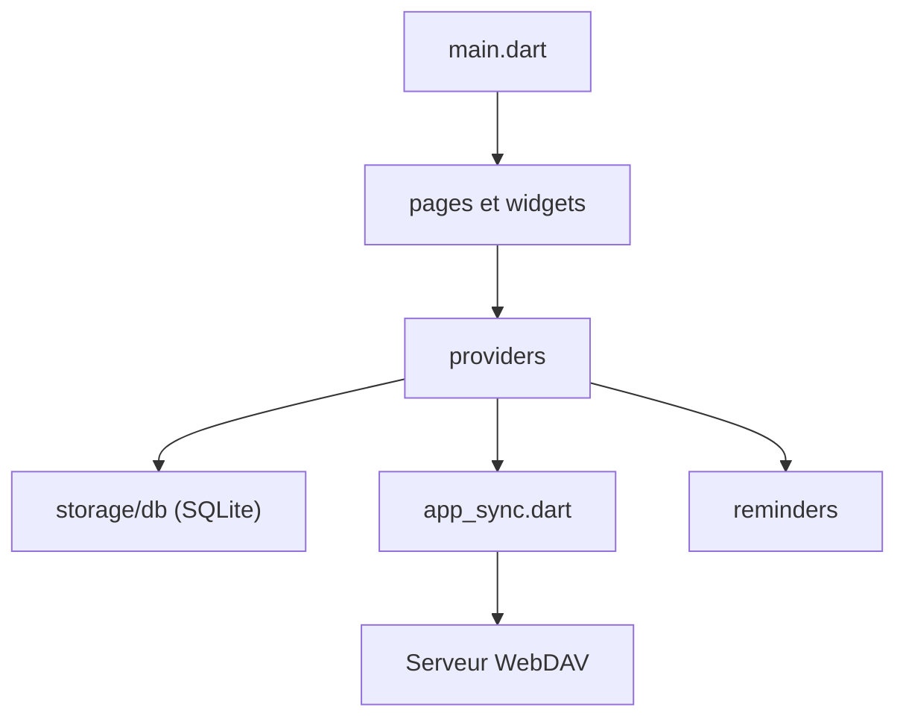

# FriesI23/mhabit

> Suivi d'habitudes multiplateforme, hors ligne, avec synchronisation WebDAV, pour qui veut garder ses données.

## Le problème
Les applis d'habitudes imposent un compte, de la publicité ou un cloud propriétaire, et ne comptent souvent que des séries de jours.

## Ce que ça fait vraiment
Application Flutter pour Android, iOS, macOS, Windows et Linux. Elle calcule un score de régularité avec courbes de progression, stocke tout dans SQLite et synchronise par WebDAV (Nextcloud, Koofr). Elle gère rappels, thèmes, import et export JSON, et migre depuis Loop Habit Tracker.

## Comment c'est branché


## Essayer
```bash
brew tap FriesI23/brew-repo
brew install table-habit
flatpak install flathub io.github.friesi23.mhabit
git clone https://github.com/FriesI23/mhabit.git
cd mhabit
make bootstrap
```

## Coût et pièges
Gratuit, Apache-2.0, sans publicité ni télémétrie annoncée. Pour synchroniser, il faut ton propre serveur WebDAV. 96 issues ouvertes.

## Ce que ce n'est pas
Pas un outil d'équipe ni de productivité en entreprise : un suivi personnel. La synchronisation n'est pas un service fourni.

## Alternatives
- Loop Habit Tracker : l'appli dont mhabit sait importer les données.

## Pour toi
À ignorer pour le métier : utile en usage perso, mais rien pour un profil data / IA / MLOps.

