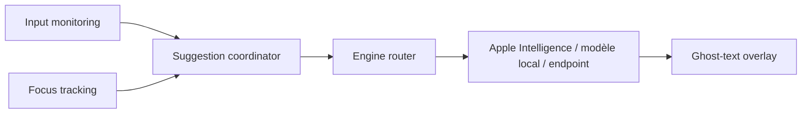

# FuJacob/cotabby

> AI autocompletion as ghost text in almost every macOS text field, running locally.

## The problem
AI writing suggestions are locked inside a few apps and often send your keystrokes to the cloud.

## What it actually does
Watches typing and the active field, builds a request, sends it to the chosen engine, and shows the suggestion in grey (Tab accepts one word). Three engines: Apple Intelligence (macOS 26+), local GGUF models via llama.cpp (Qwen3.5, gemma-4, from 0.8 to 5 GB), or an OpenAI-compatible endpoint. Adds emojis, `/` macros and autocorrect. Password fields are blocked.

## How it is wired


## Trying it
```bash
brew tap FuJacob/cotabby
brew install --cask cotabby
```

## Cost and gotchas
Free. Requires Accessibility and Input Monitoring permissions (Screen Recording optional): it is a keystroke reader. Beta, maintained by two students; AGPL-3.0 license.

## What it is not
Not a chat assistant. macOS only (14+), no Windows or Linux.

## Alternatives
The README names no alternative.

## For you
Worth watching: an interesting curiosity for local inference, but the sensitive permissions and the AGPL call for caution.
