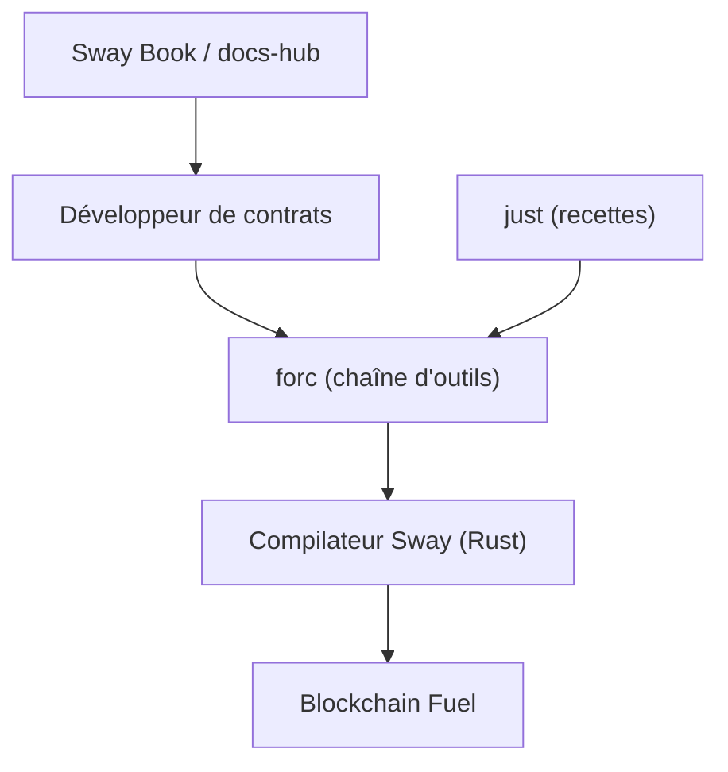

# FuelLabs/sway

> Rust-inspired programming language for writing contracts on the Fuel blockchain.

## The problem
Writing smart contracts with poorly suited languages costs security and performance. Sway aims to bring a modern language to this ecosystem.

## What it actually does
Repository of the Sway compiler and its toolchain (`forc`), written in Rust. It provides the documentation (Sway Book, standard library) in `latest`, tagged and `master` versions. A `just` recipe groups automation, benchmark, generation and tests.

## How it is wired
Simplified diagram based on the sheet, no diagram provided.


## Trying it
```bash
rustup default stable
git clone git@github.com:FuelLabs/sway.git
cd sway
cargo build
cargo run --bin forc -- --help
just --list
```

## Cost and gotchas
Free. Building requires the stable Rust toolchain. Documentation versions do not necessarily match the compiler of a given Fuel network: check with `forc --version`.

## What it is not
Not a general-purpose language: it is tied to the Fuel virtual machine. The README does not document writing contracts here, only the build.

## Alternatives
No alternative named in the README.

## For you
Ignore: blockchain contract language, with no use in data, AI or MLOps.
