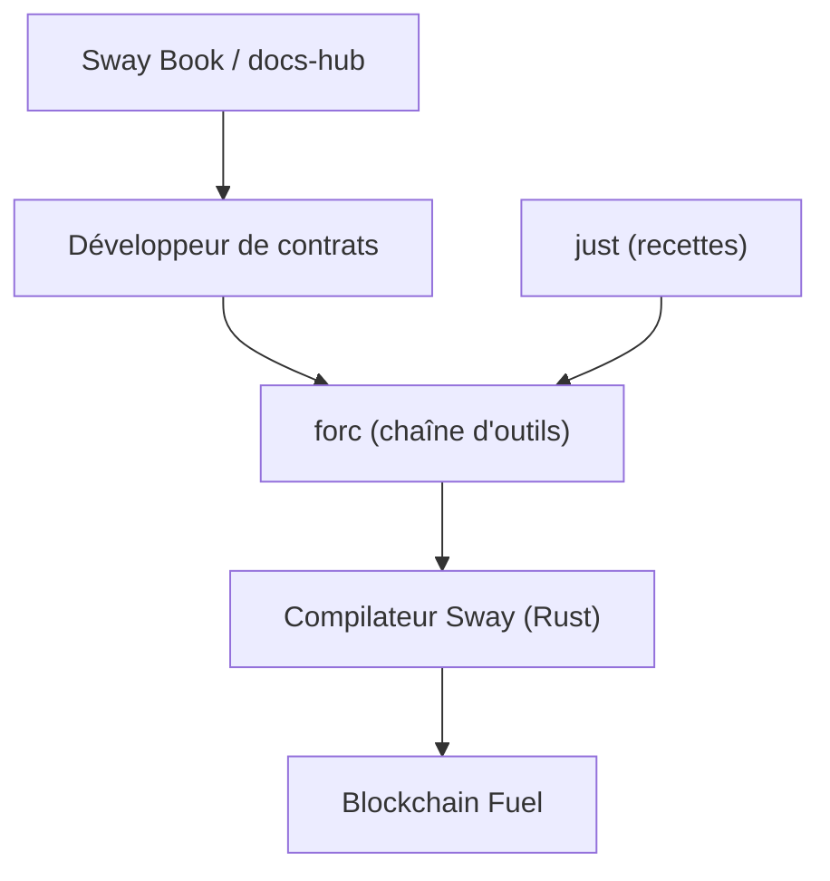

# FuelLabs/sway

> Langage de programmation inspiré de Rust pour écrire des contrats sur la blockchain Fuel.

## Le problème
Écrire des contrats intelligents avec des langages peu adaptés coûte en sécurité et en performance. Sway cherche à apporter un langage moderne à cet écosystème.

## Ce que ça fait vraiment
Dépôt du compilateur Sway et de sa chaîne d'outils (`forc`), écrits en Rust. Il fournit la documentation (Sway Book, bibliothèque standard) en versions `latest`, par étiquette et `master`. Une recette `just` regroupe automatisation, benchmark, génération et tests.

## Comment c'est branché
Schéma simplifié d'après la fiche, sans diagramme fourni.


## Essayer
```bash
rustup default stable
git clone git@github.com:FuelLabs/sway.git
cd sway
cargo build
cargo run --bin forc -- --help
just --list
```

## Coût et pièges
Gratuit. Compiler demande la chaîne Rust stable. Les versions de documentation ne correspondent pas forcément au compilateur d'un réseau Fuel donné : vérifier avec `forc --version`.

## Ce que ce n'est pas
Pas un langage généraliste : il est lié à la machine virtuelle de Fuel. Le README ne documente pas l'écriture de contrats ici, seulement le build.

## Alternatives
Aucune alternative nommée dans le README.

## Pour toi
À ignorer : langage de contrats blockchain, sans usage en data, IA ou MLOps.

