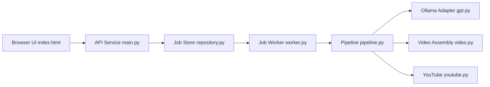

# FujiwaraChoki/MoneyPrinter

> Automatic YouTube Shorts generator from a topic, with a local Ollama LLM.

## The problem
Producing short videos in series (script, voice, editing) is repetitive.

## What it actually does
According to the architecture: minimal web UI → API (`main.py`) → Postgres job queue → worker.
The pipeline generates the script and metadata via Ollama, looks for content, synthesizes the voice, assembles the video, optionally publishes to YouTube.
Persistent queue that survives restarts.

## How it is wired


## Trying it
```bash
ollama serve
ollama pull llama3.1:8b
```

## Cost and gotchas
Local Ollama, ImageMagick required; the TikTok voice requires a `sessionid` cookie from your account.

## What it is not
Not a "money machine": it is an automated content pipeline. README is mostly an FAQ, installation is deferred to `docs/`.

## Alternatives
No alternative named in the README.

## For you
Ignore: mass content production, no data/ML interest except as an example of a Postgres job queue.
