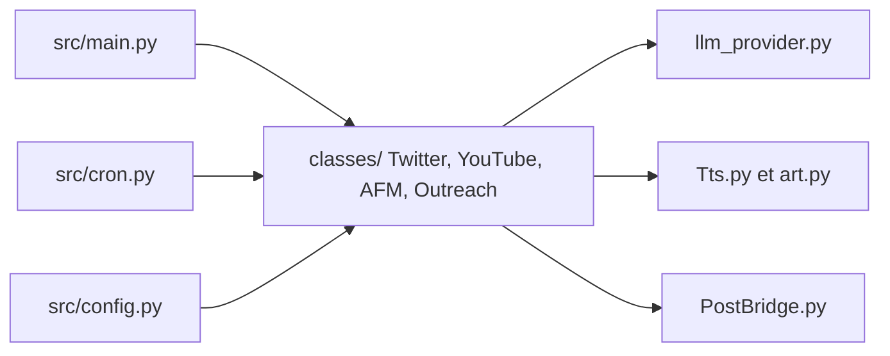

# FujiwaraChoki/MoneyPrinterV2

> Command-line Python application that automates Twitter bots, YouTube Shorts, affiliate marketing and local outreach.

## The problem
Producing and publishing content online on a regular basis takes time: ideas, voice, editing, scheduling, publishing.

## What it actually does
A single CLI application (src/main.py) offers four flows: Twitter bot, YouTube Shorts, Amazon affiliate marketing, and local business search with email outreach. A scheduler (src/cron.py) runs recurring tasks. According to the code: llm_provider.py isolates the model, Tts.py and art.py assemble the media, and a Post Bridge integration pushes the content.

## How it is wired


## Trying it
```bash
git clone https://github.com/FujiwaraChoki/MoneyPrinterV2.git
cd MoneyPrinterV2
cp config.example.json config.json
python -m venv venv
source venv/bin/activate
pip install -r requirements.txt
python src/main.py
```

## Cost and gotchas
Python 3.12 required; Go is needed for email outreach. Keys and accounts (Twitter, YouTube, Post Bridge) must be filled in config.json. AGPL-3.0 license: sharing obligations if you offer the service over a network.

## What it is not
No guaranteed income, despite the slogan: the README is limited to an "educational use" warning. Automating posts and outreach may contradict the platforms' terms of use.

## Alternatives
- MoneyPrinterTurbo: Chinese version cited in the README.

## For you
Ignore: content and outreach automation unrelated to data/AI/MLOps, under the AGPL license, and dependent on third-party services.
